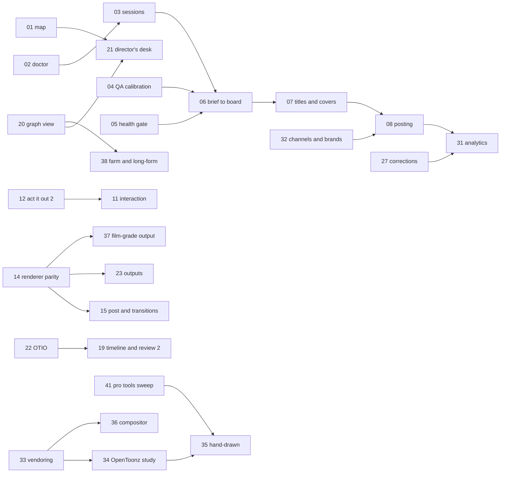

# Doodleberry work packages (from November 2026)

This is the execution plan for everything left in `docs/build-plan.md`. It groups the remaining plan items, the
"Open:" remainders of items already built, and feature-map rows that no plan item covered into work packages
(WPs). Each WP is a unit one production session can take on: it has a scope, deliverables, a measurable "done when",
dependencies, gates and a size. The build plan stays the list of items and their status; this file says in which
order, in which bundles, and how we know each is finished.

## Where things stand (2 November 2026)
- **Built:** every Phase 0, 1 and 2 item, and Phase 3 items 3.1 to 3.8 (88 commands; `python -m dbe test` runs 27
  checks). Thirty built items carry an "Open:" remainder; they are distributed into the WPs below.
- **Not started:** 3.9, 3.10, and all of Phase 4 (4.1 to 4.15).
- **The feature map is stale:** about 60 rows marked ⬜ or 🟡 are built (golden tests, schemas, visual lint, frame
  fill, safe zones, reading time, bubbles, camera grammar, foley, gesture planner, format templates, storyboard,
  timeline, posing, review room, rights, posting package, dual aspect, master to many, research gates and more).
  WP-01 reconciles it.
- **A real deadline exists:** the Q1 2027 calendar (`plan/2027-Q1.json`, 52 posts) has its first start-by date on
  **11 December 2026** (an analysis film posting 1 January), then 19, 23, 25 and 29 December. Ten of its posts are
  health topics (kidney disease, TB, dengue, snakebite, elephantiasis), which the research standard sends to an
  expert reviewer.

## Refinements to the build plan
1. **Re-scoped:** 4.4 aspect re-staging is mostly done by 1.12 (16:9 and 1:1 re-staged from the data); what remains
   is folded into WP-24. 4.10 series production builds on 2.14 (edit lists), 2.15 (series template) and 3.8 (series
   cadence), so it shrinks to continuity memory, recurring gags and a series planner.
2. **Merged:** 4.2 with 4.9 (one output pipeline for video, stills and sticker formats); 4.7 with 4.11 (library
   accounting and creator packages share the usage records); 4.12 with 4.14 and E12 (corrections, companion guides
   and living films all re-render from the facts ledger).
3. **Split:** 3.7's remainder (a Claude Code session end to end, notifications, cloud sessions) becomes WP-03; 3.8's
   remainder (re-ranking from analytics) moves to WP-31, after posts exist.
4. **Added (feature-map rows no plan item covered):** health and claims review gate; environment doctor and setup;
   multi-character interaction (handshake, hand-off, eye contact); walking along a path with foot planting; per-part
   squash and drawing substitution by angle; 12-fps-native rendering; transitions and kinetic typography; parallax
   and multiplane sets; cost and time estimate before rendering; progress events and webhooks; visual diff between
   film versions; director's desk and specialist agents; templates beyond humanoid and doodle (quadruped, bird,
   object with a face); character bible.
5. **"Done when" sharpened** for 3.9, 3.10 and every Phase 4 item (several read "as each lands" or "exists").
6. **Two new directions from the owner (2 November):** run several series with different content and branding
   (WP-32, in M2, before a second series is planned), and close the gap with professional cartoon software by
   integrating open-source codebases inside Doodleberry (M9, WP-33 to WP-41). Permissive code (MIT, BSD, Apache-2.0,
   ISC) may be vendored and modified; GPL programs stay separate processes; AGPL and non-commercial weights or data
   stay out. M9 also reopens one "Never build" entry (a frame-by-frame drawing suite) as a decision for the owner.
7. **Sizing recalibrated:** the build plan's S/M/L assumed a developer working with an agent. In practice an agent
   session finished one M item (3.5, 3.6, 3.8) or one L item (3.7) in a few hours, including tests and docs. Each WP
   below also gives **sessions**: the expected number of such working sessions.

## At a glance
| WP | Package | Milestone | Size | Sessions |
|---|---|---|---|---|
| 01 | Reconcile the plan and the feature map | M1 | S | 1 session |
| 02 | Environment doctor and one-step setup | M1 | S-M | 1 session |
| 03 | Agent sessions end to end | M1 | M | 1-2 sessions |
| 04 | Calibrate layout QA per style | M1 | S-M | 1 session |
| 05 | Health and claims review gate | M1 | S | 1 session |
| 06 | From calendar to production | M2 | M | 1 session |
| 07 | Title, thumbnail and cover lab | M2 | M | 1 session |
| 08 | Posting with a human approval per post | M2 | M | 1-2 sessions |
| 32 | Channels and brands: several series side by side | M2 | S-M | 1 session |
| 09 | Motion effects and physics, finished | M3 | M-L | 2 sessions |
| 10 | Acting intelligence 2 | M3 | M | 1-2 sessions |
| 11 | Interaction and locomotion | M3 | M-L | 2 sessions |
| 12 | Act it out 2 | M3 | M | 1-2 sessions |
| 13 | Sound depth | M3 | M | 1-2 sessions |
| 14 | Renderer parity | M4 | L | 2-3 sessions |
| 15 | Post, transitions and stepped rendering | M4 | M | 1-2 sessions |
| 16 | Sets, props, cast and templates | M4 | M-L | 2 sessions |
| 17 | Bubbles and text, finished | M4 | S | 1 session |
| 18 | Rig Canvas and doodle tools 2 | M5 | L | 2-3 sessions |
| 19 | Timeline and review room 2 | M5 | M | 1-2 sessions |
| 20 | Graph view, estimates and events | M5 | M | 1-2 sessions |
| 21 | Director's desk and specialist agents | M5 | M | 1-2 sessions |
| 22 | Editor hand-off | M6 | M | 1 session |
| 23 | Outputs for every format | M6 | M-L | 2 sessions |
| 24 | Accessibility and aspect | M6 | M | 1-2 sessions |
| 25 | Localisation depth | M6 | M | 1-2 sessions |
| 26 | Provenance, disclosure and consent | M7 | M | 1 session |
| 27 | Corrections, companions and living films | M7 | M | 1-2 sessions |
| 28 | Series production | M7 | M | 1 session |
| 29 | Library economics and creator packages | M7 | M-L | 2 sessions |
| 30 | Other mediums | M7 | M each | 1 session |
| 31 | Analytics and a plan that re-ranks itself | M8 | M-L | 2 sessions |
| 33 | Vendoring rules and tooling | M9 | S | 1 session |
| 34 | OpenToonz study and decision | M9 | M | 1 session |
| 35 | Hand-drawn animation | M9 | L | 3+ sessions |
| 36 | Compositor and multiplane camera | M9 | L | 2-3 sessions |
| 37 | Film-grade colour and delivery | M9 | M-L | 2 sessions |
| 38 | Long-form and render farm | M9 | L | 2-3 sessions |
| 39 | Team roles and permissions | M9 | M | 1 session |
| 40 | Sound editing in Studio | M9 | M | 1-2 sessions |
| 41 | Professional tools sweep | M9 | S-M | 1 session of parallel research agents |

41 packages, about 54 to 71 agent working sessions in all (WP-30 counts once; it is M per medium).

## Definition of done (every WP)
- Features are `@command` functions in `dbe/commands.py` (CLI, HTTP, Studio and MCP at once), with JSON-safe
  arguments and results; any UI is a Studio page that calls only commands.
- A self-test in `python -m dbe test` that fails when the feature breaks (synthetic inputs where real ones are
  external), and the whole suite green before commit; golden frames updated only for intended visual changes.
- A measured demonstration of the "done when" (numbers in the commit message and the plan's status row).
- `docs/dbe.md` section, build-plan status row, feature-map rows updated; every new dependency or asset in
  `assets/manifest.json` and checked against `docs/oss-research.md`; puppet-format changes bump `version` and reach
  `puppet.js`, `acting.js`, `bake.mjs`, `dbe/geom.py` and the exporters together.
- Nothing downloaded (asset packs, renders, voices, models) committed; anything that spends money, posts publicly
  or runs paid sessions waits for the owner's go-ahead.

## Milestones
| Milestone | When | WPs | Why this order |
|---|---|---|---|
| **M1 Ready to produce** | now to 4 Dec | 01-05 | reliable environment, agent sessions proved, gates calibrated, before Q1 production starts |
| **M2 First quarter on air** | 4 Dec to 11 Dec, then runs through Q1 | 06-08, 32 | the first start-by is 11 Dec; titles, covers and posting must exist before the first post on 1 Jan; channels before a second series |
| **M3 Acting and motion depth** | Dec to Jan | 09-13 | the biggest quality gains for Q1 films still in production |
| **M4 Look and renderer parity** | Jan | 14-17 | parity first, so new looks reach every renderer at once |
| **M5 Artist and director tools** | Jan to Feb | 18-21 | interfaces over a stable core |
| **M6 Reach** | Feb | 22-25 | outputs, accessibility and languages for a catalogue that now exists |
| **M7 Trust, community, economy** | Feb to Mar | 26-30 | needs published films and their facts ledgers |
| **M8 Learning loop** | from mid-Feb (six weeks of posts) | 31 | needs real performance data |
| **M9 Professional parity through open source** | Mar to Jun | 33-41 | vendoring rules first, then the largest gaps, each behind a licence check and the owner's decisions |
| Gated, unscheduled | | procedural layer 5A/5B/5C | each behind its gate in the build plan |

Work-package IDs are stable labels, not an order: the milestones give the order.

## M1 Ready to produce (now to 4 December)

**WP-01 Reconcile the plan and the feature map** (S, 1 session)
- Scope: mark built rows ✅ with the command that does it; mark partial rows 🟡 with what is left; point each open
  row at its WP. A `docs.check` command that cross-checks the build-plan status table, the feature map and the
  command registry (every command named in the docs exists; every plan item has a status row; no ✅ row without a
  command or file).
- Done when: `docs.check` passes in `python -m dbe test`, and the feature map's open P0 rows each name a WP.

**WP-02 Environment doctor and one-step setup** (S-M, 1 session)
- Learned the hard way this session: pip stalls on large wheels (curl downloads worked), MediaPipe needs `libegl1`,
  scipy and the voice stack were missing, Kokoro model files and the timed model are fetched by hand.
- Scope: `engine.doctor` (Python packages and versions against the requirements files, system libraries, Node and
  Playwright's browser, ffmpeg, model files with their pinned sha256, voices, disk) with the exact fix for each gap;
  `tools/setup.sh` (idempotent: apt packages, wheels fetched with curl and installed from a local folder, models,
  voices); the cloud environment's setup script documented.
- Done when: a fresh container goes from clone to a green `python -m dbe test` with one script, and `engine.doctor`
  reports every check green.

**WP-03 Agent sessions end to end** (M, 1-2 sessions; needs the owner's go-ahead for session spend)
- Scope: run the `claude` runner on a real Q1 brief in a scratch clone, research gate to final checkpoint to merge;
  fix protocol gaps it finds; record time and token cost per film. Owner notifications on escalation, failure and
  ready-for-approval (progress events and webhooks, feature map §11); start cloud sessions from the board through the
  manual runner's protocol.
- Done when: one film from a brief is made by a Claude Code session, escalates once on seeded counter-evidence, is
  approved and merged, and the owner was notified at each stop; cost per film is in the board's measurements.

**WP-04 Calibrate layout QA per style** (S-M, 1 session; the build plan's gate before enforcing 0.11)
- Scope: run frame fill, seams and reading time on reference films in each style (flat paper explainer, doodle,
  cartoon cast); set per-style thresholds in `dbe/profiles.json`; enforce the calibrated checks.
- Done when: every benchmark film passes its style's thresholds, and a seeded failure in each style fails QA.

**WP-05 Health and claims review gate** (S, 1 session)
- Scope: a brief field and ledger role for expert review (`expert_review`), set automatically for health, legal and
  finance fields; renders refuse to reach the final checkpoint without a cleared expert review; honest on-screen
  labels (re-analysis, illustration, preliminary) checked against facts.json labels; what the source omits recorded.
- Done when: the ten Q1 health posts carry the flag in their briefs, and a health film cannot be approved on the
  board without a recorded expert review.

## M2 First quarter on air (4 to 11 December, then through Q1)

**WP-06 From calendar to production** (M, 1 session; feature map E24)
- Scope: `plan.brief` picks a format template by the row's format (myth_vs_data for the series, explainer,
  dialogue), drafts the storyboard with `film.from_template` from the idea's fields, sets research instructions with
  the fact-lock date, and puts it on the board with its posting date; the tracker reads the fact gate from the film's
  workspace; the board shows each film's plan row (start-by, fact-lock, posting date).
- Done when: the first eight Q1 rows go from calendar to a storyboard passing `storyboard.check` to a running session
  in one command each, and the tracker shows them on schedule.

**WP-07 Title, thumbnail and cover lab** (M, 1 session; plan 3.9)
- Scope: title candidates written for newcomers that are literally true; double-barrel thumbnail text; candidates
  checked against facts.json (the packaging truth check: no claim in a title or cover that the film does not
  support); deliberate cover frames per cut and platform (chosen frame plus brand-kit text); back-catalogue retitling.
- Done when: every merged film has two true title options, a cover per cut and platform, and the truth check fails a
  seeded misleading title.

**WP-08 Posting with a human approval per post** (M, 1-2 sessions; plan 4.15; publishing gate)
- Scope: a posting queue from `film.package` outputs and the calendar; per-post approval on the board; connectors
  only where platform terms allow automation, otherwise an export with a reminder; posted links back into
  `plan.posted`; multi-language audio tracks where the platform supports them.
- Done when: a week of approved Q1 posts goes out on schedule (or is exported with reminders), none without an
  approval, and the tracker shows them posted.

**WP-32 Channels and brands: several series side by side** (S-M, 1 session; owner request)
- Today: one channel (`plan/channel.json`), one idea bank, one brand kit (`brand/brand.json`). Films can already look
  and sound different (brand, cast, sets, voices and formats are per film), and the board runs any mix of films.
- Scope: channels by id (`plan/channels/<id>.json`: audience, fields, locale, rules, brand kit, default cast and
  voices); ideas and calendars tagged by channel, with sweeps run per channel; `plan.schedule` and `plan.check` per
  channel, plus a cross-channel view (no two channels posting the same subject the same week, if wanted); several
  brand kits (`brand/<id>.json`), with a channel's films inheriting its brand, cast and voices; `prod.plan` records the
  channel; the board and the Plan page filter and colour by channel. The current files migrate to a first channel.
- Done when: two channels with different audiences, fields, rules and brands each get a quarter that passes its own
  rules, films from each render in their own brand, and the board shows both apart.

## M3 Acting and motion depth (December to January)

**WP-09 Motion effects and physics, finished** (M-L, 2 sessions; open from 2.19, 2.20)
- Scope: smear frames and motion arcs; multi-body scenes with deterministic Rapier; squash on impact; contacts
  retimed onto the beat grid.
- Done when: a juggling scene of three props is solved, lands on beats, gets smears and arcs, and reruns hash-equal.

**WP-10 Acting intelligence 2** (M, 1-2 sessions; open from 2.3, 2.4, 2.11)
- Scope: semantic gestures from LLM tags (agent output validated against the clip library); personality profiles
  (E13) that shape tempo, energy and gesture choice; camera beats in gags (push-in on the stare); a critic's rating
  of acting and gag timing against a hand-keyed baseline.
- Done when: two characters with different profiles act the same script visibly differently, and the critic rates the
  planner at or above the hand-keyed version on a blind pair.

**WP-11 Interaction and locomotion** (M-L, 2 sessions; new from the feature map)
- Scope: handshake, hug, hand-off and eye contact (IK targets on another character's parts); walking along a path
  with foot planting; per-part squash and stretch; drawing substitution driven by angle; per-pose z-order. Puppet
  format v0.8 if new fields are needed.
- Done when: two characters walk to each other along a curved path without foot sliding (measured), shake hands with
  hands meeting within 2 px, and every renderer plays it.

**WP-12 Act it out 2** (M, 1-2 sessions; open from 3.5)
- Scope: head turn (yaw) into the `turn` control (clip control tracks, a puppet-format change); rtmlib RTMPose as a
  second detector; multi-person takes (one clip per person); camera-motion compensation from the background; live
  tracking (E9) as a P2 follow-on.
- Done when: a take with a head turn and a camera pan becomes a clip whose head turns and whose root does not drift,
  and two people in one take become two clips.

**WP-13 Sound depth** (M, 1-2 sessions; open from 2.1, 2.7, 2.13, 2.16)
- Scope: foley surfaces and room reverb per set; Kenney CC0 samples (manifest); human voice-over import with
  phone-level alignment (CTC or MFA) and recorded takes fitted to slots with `atempo`; prosody direction (whisper,
  shout, excited) where the TTS allows it.
- Done when: a recorded human line drops into a slot with visemes within 40 ms of a hand check, and footsteps sound
  different on grass and tile.

## M4 Look and renderer parity (January)

**WP-14 Renderer parity** (L, 2-3 sessions; open from 1.1, 1.7, 1.8, 2.13, 2.20 and 3.5)
- Scope: raster parts, toon shading, motion effects, clip-driven z order, props and the sound-off time warp in Synfig,
  Lottie and Grease Pencil, or a clear refusal where a renderer cannot; a parity golden test that renders the same
  shot in each renderer and compares silhouettes.
- Done when: the parity test passes for every benchmark shot on every renderer that accepts it.

**WP-15 Post, transitions and stepped rendering** (M, 1-2 sessions; open from 1.7; feature map §4, §7)
- Scope: cross-dissolves, match cuts and wipes; sub-frame motion blur on fast shots only; kinetic typography beyond
  word highlights; parallax and multiplane set layers; 12-fps-native rendering (render only unique stepped frames).
- Done when: a doodle film on twos renders in at most 60% of today's time with identical frames, and each transition
  passes the seam check.

**WP-16 Sets, props, cast and templates** (M-L, 2 sessions; open from 1.5, 1.6; licence gate before 1.6)
- Scope: map board (Natural Earth plus d3-geo), anatomy plates (Servier, CC BY), Kenney prop packs; Open Peeps and
  Humaaans converted; outfits as swap sets; templates for a quadruped, a bird and an object with a face, each with a
  clip library; a character bible (personality, voice, gesture tendencies, continuity notes) in the cast registry.
- Done when: a Q1 analysis film uses the map board; three new templates each pass a clip set on every renderer;
  every new file is in the manifest.

**WP-17 Bubbles and text, finished** (S, 1 session; open from 2.10)
- Scope: thought clouds, narration boxes, letter-by-letter typewriter with punctuation pauses.
- Done when: the sound-off cut of a dialogue film uses all three and passes the reading-time rule.

## M5 Artist and director tools (January to February)

**WP-18 Rig Canvas and doodle tools 2** (L, 2-3 sessions; open from 1.3, 1.4, 1.8, 3.6)
- Scope: expression and mouth-chart boards side by side with onion skin; model sheet and turnaround board; polygon
  editing of suggested cuts; several characters on one page; pupils, turn views and chains drawn over ghost guides;
  Krita `.kra` import; click-to-mask cut suggestions with SAM 2.1 tiny or small (1.8b).
- Done when: a page with two doodles becomes two puppets, and a doodle gains pupils and a three-quarter view through
  drawing requests alone.

**WP-19 Timeline and review room 2** (M, 1-2 sessions; open from 3.1, 3.4; after WP-22)
- Scope: dragging lines and shots; a camera-keys lane; review notes about gaze, placement, camera and the timing of
  lines; review on a phone; a visual diff between two versions of a film; OpenRV or xSTUDIO through OTIO.
- Done when: "Ravi should look at Momo when she answers" is fixed and verified by the critic, and the diff view
  shows exactly the frames that changed.

**WP-20 Graph view, estimates and events** (M, 1-2 sessions; plan 3.10; feature map §11)
- Scope: React Flow node view of facts, script, shots and renders with per-node cache state and why a node is stale;
  re-cook downstream only; a cost and time estimate before rendering (frames times renderer rate, measured);
  progress events and webhooks for long jobs.
- Done when: clicking a stale node shows the changed input and re-cooks only its downstream nodes, and the estimate
  is within 20% of the measured render time on the benchmark films.

**WP-21 Director's desk and specialist agents** (M, 1-2 sessions; feature map §11, §12; after WP-01 and WP-20)
- Scope: a chat beside the storyboard strip and animatic; role command subsets for director, animator, editor, critic
  and fact-checker (what each may call); natural-language edits routed to the right commands.
- Done when: a director edits a film by chat alone through five kinds of change, and each role is refused commands
  outside its subset.

## M6 Reach (February)

**WP-22 Editor hand-off** (M, 1 session; plan 4.1)
- Scope: OTIO, FCPXML and EDL with stems and captions; a round trip through `melt`.
- Done when: a film opens in Kdenlive (and Resolve, where available) with shots, stems and captions in place, and the
  `melt` round trip renders frames identical to ours.

**WP-23 Outputs for every format** (M-L, 2 sessions; plans 4.2 and 4.9; ThorVG licence gate)
- Scope: WebM and ProRes with alpha; GIF and APNG; line-art GIFs (32 colours, Bayer dithering); sticker and emoji packs
  (Telegram WebM and TGS, WhatsApp WebP, Giphy GIF, iMessage APNG); print-ready stills; dotLottie with palette
  themes; Lottie QA in two independent renderers.
- Done when: one character exports to four sticker platforms within each platform's limits, and Lottie exports pass
  golden checks in lottie-web and a second renderer.

**WP-24 Accessibility and aspect** (M, 1-2 sessions; plans 4.3 and 4.4's remainder)
- Scope: audio description generated from shot data (E5); flash check (WCAG 2.3); colour-blind check on frames;
  reduced-motion variant; one command for 9:16, 16:9 and 1:1 with per-aspect QA.
- Done when: every final ships with an AD track and passes the flash check, and the three aspects pass QA from one
  command.

**WP-25 Localisation depth** (M, 1-2 sessions; plan 4.5; open from 1.15)
- Scope: translated on-screen text in sets and kit elements; right-to-left and complex scripts; cultural swaps of sets
  and props; a clean Sinhala voice (search and licence check first; none is known today).
- Done when: an Arabic version renders correctly end to end, and a Sinhala version ships with captions and, if a clean
  voice exists, voice.

## M7 Trust, community, economy (February to March)

**WP-26 Provenance, disclosure and consent** (M, 1 session; plan 4.6; C2PA licence gate)
- Scope: C2PA content credentials on finals; AI-disclosure labels per platform; likeness and consent records for
  characters and voices.
- Done when: finals carry signed provenance that verifies with a reference tool, and a voice without a consent
  record is refused.

**WP-27 Corrections, companions and living films** (M, 1-2 sessions; plans 4.12, 4.14, 4.8's E12)
- Scope: a dated corrections log per film that propagates to captions, titles, covers and credits; runnable companion
  guides that reproduce a film's numbers from its analysis scripts; send-a-myth intake into the idea bank; films that
  re-render when their facts change.
- Done when: one correction updates the page, captions, title and credits in one command, and a companion guide
  reproduces every number in its film.

**WP-28 Series production** (M, 1 session; plan 4.10, re-scoped)
- Scope: continuity memory (who knows what, running gags, props that persist); recurring gags as data; a series
  planner on top of 3.8; teaching mode that turns a pipeline into a tutorial.
- Done when: ten episodes of a series are planned, rendered and scheduled from data with continuity checked.

**WP-29 Library economics and creator packages** (M-L, 2 sessions; plans 4.7 and 4.11)
- Scope: usage accounting from `shots.json` (screen time per asset, E15); contributor flow through `cast.add`; rig,
  boil-preset and loop-pack templates; handwriting fonts from an artist's samples (font-tool licence check).
- Done when: a per-asset screen-time report covers the whole catalogue, and a creator packages a rig template that
  installs into another project.

**WP-30 Other mediums** (M each; plan 4.8)
- Scope: comics and storybooks from shot data (Typst), one character in every medium (E6), interactive web films,
  Godot export.
- Done when (each): a film becomes a printable comic, or an interactive web film, from its data alone.

## M8 Learning loop (from mid-February)

**WP-31 Analytics and a plan that re-ranks itself** (M-L, 2 sessions; plan 4.13, E11, E31; open from 3.8)
- Scope: the 48-hour metrics checklist; ingestion per platform where terms allow (manual import otherwise);
  retention curves mapped onto shots and lines; hook variants tested (E11); the idea bank and next quarter's calendar
  re-ranked by what performed; a business dashboard (revenue by platform and geography, RPM, catalogue value).
- Done when: Q2 2027's calendar is planned with measured Q1 performance and the change it made is explained row by
  row.

## M9 Professional parity through open source (March to June)
Where Doodleberry still trails professional cartoon tools (Toon Boom Harmony, Moho, TVPaint, Blender's Grease Pencil,
After Effects): hand-drawn frame-by-frame animation, a compositor, film-grade colour and delivery, long-form scale,
team features and sound editing. The owner's direction is to close these by bringing open-source codebases inside
Doodleberry and modifying them. Every component below passes WP-33's rules first.

**WP-33 Vendoring rules and tooling** (S, 1 session; first in M9)
- Scope: `vendor/<name>/` with `UPSTREAM.json` (repository, version or commit, licence, files taken, local patches as
  small commits) and the original licence and notices; a `vendor.check` command that refuses a vendored component
  whose licence class is not allowed inside (GPL and AGPL code, non-commercial weights or data), whose notices are
  missing, or that has no manifest row; each vendored component wrapped behind `@command`s with a self-test, so an
  upstream update cannot silently break films.
- Done when: one existing dependency is vendored this way end to end, and `vendor.check` fails a seeded GPL file.

**WP-41 Professional tools sweep** (S-M, 1 session of parallel research agents; owner go-ahead for the spend)
- Scope: agents read the manuals and release notes of Harmony, Moho, TVPaint, Blender Grease Pencil, After Effects,
  OpenToonz and Synfig, and write a structured inventory: each capability in our own words, how professionals use it,
  and our match (a command, a field, a metric, or a gap with a WP). No copied text, icons or UI.
- Done when: the inventory covers every chapter of each manual, each gap names a WP or "won't build", and the feature
  map is updated from it.

**WP-34 OpenToonz study and decision** (M, 1 session)
- OpenToonz is the main BSD-3-Clause codebase in this space (some third-party parts carry their own licences).
- Scope: confirm the licence of each part we would take; build it headless; identify reusable parts (exposure-sheet
  model, level formats, drawing and fill tools, `tcomposer` rendering); decide per part: vendor and modify, call as a
  program, or reimplement from the idea.
- Done when: a written decision per part with its licence, and one part working behind a command (for example
  rendering a scene from data with `tcomposer`).

**WP-35 Hand-drawn animation** (L, 3+ sessions; needs the owner to move "a frame-by-frame drawing suite" off the
Never build list)
- Scope: drawn levels as a new part type (a sequence of drawings with exposures, puppet format change); onion skins;
  an exposure sheet (X-sheet) for timing on ones, twos and threes; key poses with in-between assistance; cleanup of
  rough lines; hand-drawn effects (fire, water, smoke) as drawn levels; built on WP-34's decisions and the Rig
  Canvas's brush.
- Done when: an animator draws a 2-second hand-drawn effect and a 12-drawing walk on twos in Studio, and both play in
  a film beside rigged puppets, with golden frames.

**WP-36 Compositor and multiplane camera** (L, 2-3 sessions)
- Scope: a per-shot node compositor (masks, mattes, blend modes, glows, light wraps) rendered deterministically;
  true 2D multiplane depth (layers on planes, parallax, depth of field) in the SVG and WebGL path; the graph view
  (WP-20) as its editor.
- Done when: a night shot with three depth planes, a glow and a mask renders identically on rerun and matches its
  golden frames.

**WP-37 Film-grade colour and delivery** (M-L, 2 sessions)
- Scope: colour management (OpenColorIO, ACES), OpenEXR multi-pass output (beauty, line, shadow, mattes), 4K and
  higher-frame-rate masters, an HDR master where the pipeline allows it, and a cinema-style package as a delivery
  profile (external tools as separate programs if GPL).
- Done when: a film renders a 4K ACES EXR multi-pass master that a reference tool reads, and the social encodes are
  derived from it.

**WP-38 Long-form and render farm** (L, 2-3 sessions; after WP-20)
- Scope: distributed render workers across machines (OpenCue, Apache-2.0, or in-house queue), shared cache by content
  hash, scheduling by cost estimate; a long-form test (a 20-minute episode) for memory, cache and assembly limits.
- Done when: a 20-minute episode renders on three workers in a third of one machine's time, with frames identical to
  a single-machine render.

**WP-39 Team roles and permissions** (M, 1 session)
- Scope: people and roles (owner, director, artist, reviewer, editor) with the command subsets of WP-21; assignments
  and locks on films and characters; an audit log of who changed what.
- Done when: an artist can edit a character but not approve a film, and every change appears in the audit log.

**WP-40 Sound editing in Studio** (M, 1-2 sessions)
- Scope: waveform lanes for voice, music, foley and effects in the timeline; moving, trimming and replacing cues;
  stems; a permissively licensed waveform component (licence checked) vendored through WP-33.
- Done when: a sound designer moves a foley hit and swaps a music cue in Studio, and the mix re-renders with the
  change at the right frame.

## Decisions for the owner
- **Frame-by-frame drawing** (WP-35): today it is on the Never build list ("import from Krita instead"). Building it
  through WP-34 and WP-35 needs the owner to move it off that list.
- **GPL code inside Doodleberry:** merging GPL code (Blender, Synfig, Krita, Inkscape, Piper, espeak-ng) would make
  Doodleberry GPL. The plan keeps them as separate programs unless the owner decides to license Doodleberry under
  the GPL.
- **Spend:** WP-03 (Claude Code film sessions) and WP-41 (research agents) cost model usage; each waits for a
  go-ahead with an estimate.

## Risks and how the plan handles them
- **Licences:** each WP that adds a library or asset passes `docs/oss-research.md` first; the open questions
  (BodyParts3D, `thorvg-python`, the C2PA SDK, sherpa-onnx's espeak code, sound libraries) sit in WP-16, WP-23 and
  WP-26 as gates, not afterthoughts.
- **Platform terms:** posting and analytics automate only where terms allow; otherwise exports and manual import.
- **CPU contention:** the container has four cores; production sessions (renders) and development sessions compete.
  During Q1, keep `max_parallel` at 2 while a development WP is running.
- **Session spend:** WP-03 measures the cost per film before the claude runner is used at volume.
- **Research quality:** sweeps and sessions may cite pages they could not fully read; the fact gate, the expert review
  (WP-05) and the URL check stay mandatory, and research that contradicts a brief escalates to the owner.
