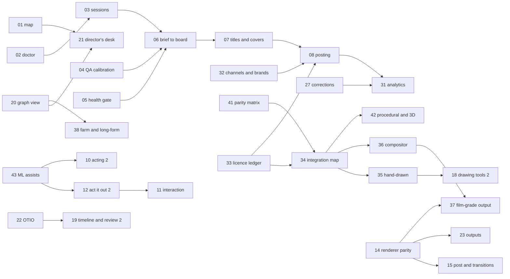

# Doodleberry work packages (from November 2026)

This is the execution plan for everything left in `docs/build-plan.md`. It groups the remaining plan items, the
"Open:" remainders of items already built, and feature-map rows that no plan item covered into work packages
(WPs). Each WP is a unit one production session can take on: it has a scope, deliverables, a measurable "done when",
dependencies, gates and a size. The build plan stays the list of items and their status; this file says in which
order, in which bundles, and how we know each is finished.

## Where things stand (2 November 2026)
- **Built:** every Phase 0, 1 and 2 item, and Phase 3 items 3.1 to 3.8 (88 commands; `python -m dbe test` runs 27
  checks). Thirty built items carry an "Open:" remainder; they are distributed into the WPs below.
- **Not started:** 3.9, 3.10, and all of Phase 4 (4.1 to 4.15).
- **The feature map is stale:** about 60 rows marked ⬜ or 🟡 are built (golden tests, schemas, visual lint, frame
  fill, safe zones, reading time, bubbles, camera grammar, foley, gesture planner, format templates, storyboard,
  timeline, posing, review room, rights, posting package, dual aspect, master to many, research gates and more).
  WP-01 reconciles it.
- **A real deadline exists:** the Q1 2027 calendar (`plan/2027-Q1.json`, 52 posts) has its first start-by date on
  **11 December 2026** (an analysis film posting 1 January), then 19, 23, 25 and 29 December. Ten of its posts are
  health topics (kidney disease, TB, dengue, snakebite, elephantiasis), which the research standard sends to an
  expert reviewer.

## Refinements to the build plan
1. **Re-scoped:** 4.4 aspect re-staging is mostly done by 1.12 (16:9 and 1:1 re-staged from the data); what remains
   is folded into WP-24. 4.10 series production builds on 2.14 (edit lists), 2.15 (series template) and 3.8 (series
   cadence), so it shrinks to continuity memory, recurring gags and a series planner.
2. **Merged:** 4.2 with 4.9 (one output pipeline for video, stills and sticker formats); 4.7 with 4.11 (library
   accounting and creator packages share the usage records); 4.12 with 4.14 and E12 (corrections, companion guides
   and living films all re-render from the facts ledger).
3. **Split:** 3.7's remainder (a Claude Code session end to end, notifications, cloud sessions) becomes WP-03; 3.8's
   remainder (re-ranking from analytics) moves to WP-31, after posts exist.
4. **Added (feature-map rows no plan item covered):** health and claims review gate; environment doctor and setup;
   multi-character interaction (handshake, hand-off, eye contact); walking along a path with foot planting; per-part
   squash and drawing substitution by angle; 12-fps-native rendering; transitions and kinetic typography; parallax
   and multiplane sets; cost and time estimate before rendering; progress events and webhooks; visual diff between
   film versions; director's desk and specialist agents; templates beyond humanoid and doodle (quadruped, bird,
   object with a face); character bible.
5. **"Done when" sharpened** for 3.9, 3.10 and every Phase 4 item (several read "as each lands" or "exists").
6. **New directions from the owner (2 November):**
   - **Several series** with different content and branding: WP-32, in M2, before a second series is planned.
   - **Professional 2D+ parity is a must**, and beyond it: it becomes the main development lane from December (about
     two thirds of development sessions), not a late milestone.
   - **All open-source code may be used**, because Doodleberry is in-house R&D and is not distributed: GPL and AGPL
     code may be vendored, modified and linked in, and non-commercial or research-only models and data may be used
     in-house. The licence ledger (WP-33) records every component's class, and the posting gate flags a public film
     that used a restricted input. The frame-by-frame drawing suite leaves the Never build list (WP-35).
7. **Sizing recalibrated:** the build plan's S/M/L assumed a developer working with an agent. In practice an agent
   session finished one M item (3.5, 3.6, 3.8) or one L item (3.7) in a few hours, including tests and docs. Each WP
   below also gives **sessions**: the expected number of such working sessions.

## At a glance
| WP | Package | Lane | When | Size | Sessions |
|---|---|---|---|---|---|
| 01 | Reconcile the plan and the feature map | studio | now to 4 Dec | S | 1 session |
| 02 | Environment doctor and one-step setup | studio | now to 4 Dec | S-M | 1 session |
| 03 | Agent sessions end to end | studio | now to 4 Dec | M | 1-2 sessions |
| 04 | Calibrate layout QA per style | studio | now to 4 Dec | S-M | 1 session |
| 05 | Health and claims review gate | studio | now to 4 Dec | S | 1 session |
| 33 | Licence ledger and vendoring | parity | now to 4 Dec | S | 1 session |
| 41 | Parity matrix (professional tools sweep) | parity | now to 4 Dec | S-M | 1 session of parallel research agents |
| 06 | From calendar to production | studio | 4 to 11 Dec | M | 1 session |
| 07 | Title, thumbnail and cover lab | studio | 4 to 11 Dec | M | 1 session |
| 32 | Channels and brands: several series side by side | studio | 4 to 11 Dec | S-M | 1 session |
| 34 | Open-source integration map | parity | 4 to 11 Dec | M | 1-2 sessions |
| 08 | Posting with a human approval per post | studio | by 1 Jan | M | 1-2 sessions |
| 09 | Motion effects and physics, finished | parity | Dec to Feb | M-L | 2 sessions |
| 11 | Interaction and locomotion | parity | Dec to Feb | M-L | 2 sessions |
| 14 | Renderer parity | parity | Dec to Feb | L | 2-3 sessions |
| 35 | Hand-drawn animation | parity | Dec to Feb | L | 3+ sessions |
| 36 | Compositor and multiplane camera | parity | Dec to Feb | L | 2-3 sessions |
| 22 | Editor hand-off | studio | Feb to Apr | M | 1 session |
| 23 | Outputs for every format | studio | Feb to Apr | M-L | 2 sessions |
| 24 | Accessibility and aspect | studio | Feb to Apr | M | 1-2 sessions |
| 25 | Localisation depth | studio | Feb to Apr | M | 1-2 sessions |
| 31 | Analytics and a plan that re-ranks itself | studio | Feb to Apr | M-L | 2 sessions |
| 15 | Post, transitions and stepped rendering | parity | Feb to Apr | M | 1-2 sessions |
| 18 | Rig Canvas and doodle tools 2 | parity | Feb to Apr | L | 2-3 sessions |
| 19 | Timeline and review room 2 | parity | Feb to Apr | M | 1-2 sessions |
| 20 | Graph view, estimates and events | parity | Feb to Apr | M | 1-2 sessions |
| 37 | Film-grade colour and delivery | parity | Feb to Apr | M-L | 2 sessions |
| 40 | Sound editing in Studio | parity | Feb to Apr | M | 1-2 sessions |
| 42 | Procedural and 3D layer (2D+) | parity | Feb to Apr | L | 3 sessions |
| 43 | ML assists, in-house | parity | Feb to Apr | M-L | 2 sessions |
| 26 | Provenance, disclosure and consent | studio | Apr to Jun | M | 1 session |
| 27 | Corrections, companions and living films | studio | Apr to Jun | M | 1-2 sessions |
| 28 | Series production | studio | Apr to Jun | M | 1 session |
| 29 | Library economics and creator packages | studio | Apr to Jun | M-L | 2 sessions |
| 30 | Other mediums | studio | Apr to Jun | M each | 1 session |
| 10 | Acting intelligence 2 | parity | Apr to Jun | M | 1-2 sessions |
| 12 | Act it out 2 | parity | Apr to Jun | M | 1-2 sessions |
| 13 | Sound depth | parity | Apr to Jun | M | 1-2 sessions |
| 16 | Sets, props, cast and templates | parity | Apr to Jun | M-L | 2 sessions |
| 17 | Bubbles and text, finished | parity | Apr to Jun | S | 1 session |
| 21 | Director's desk and specialist agents | parity | Apr to Jun | M | 1-2 sessions |
| 38 | Long-form and render farm | parity | Apr to Jun | L | 2-3 sessions |
| 39 | Team roles and permissions | parity | Apr to Jun | M | 1 session |

43 packages, about 59 to 78 agent working sessions in all; the parity lane is 24 packages and 37 to 51 sessions. WP-30 counts once (it is M per medium).

## Progress
| WP | Result | Date |
|---|---|---|
| 01 | done: feature map reconciled against the code (238 open rows reviewed; now 162 built, 53 partial, 72 open, each open row naming its WP), package scopes extended for the rows they now own, `docs.check` (commands named exist, open rows point at WPs, WP references exist, plan items covered, packages scheduled) in `python -m dbe test` | 2 Nov 2026 |
| 05 | done: expert review for health, legal and finance (channel rule, `review` on calendar rows and in briefs, `omits` required per fact, `research.check` reports pending, `prod.approve` refuses until a reviewer clears it; tested through the orchestrator), honest labels drawn with the captions; Q1's ten health posts marked | 2 Nov 2026 |
| 33 | done: licence classes for every component (`licence.ledger`), `film.provenance` posting flags (in `film.package`), `UPSTREAM.json` records and `vendor.check` (in the test suite) for lottie-web, three.js, perfect-freehand and the newly vendored Potrace 1.16 (GPL) and VTracer 0.6.5 (MIT; updated to the latest on 3 Nov) sources. Built with the owner's permission (4 Nov): potrace 1.16 by its configure and make, vtracer 0.6.5 by cargo, both into out/vendor-build/; they trace raster parts to vector (`puppet.vectorize`, test `vectorize`). | 4 Nov 2026 |
| 03 | done: a Claude Code session made the 2 January 2027 film ("Closest to the Sun in January") from its calendar row in a scratch clone: the brief's hook was seeded false, research contradicted it and the film escalated (owner notified by webhook), the owner narrowed the brief, a second session researched, voiced, rendered and ran four critic rounds on its own (committing each), QA 15/15, final ready (owner notified), approved and merged. Cost on the board: $17.49 over two sessions (the first $2.86 in 5 minutes, the second $14.63 in about 83). Protocol gaps found and fixed: the final now fails while the film's director asks for "one more pass"; session time is the wall clock. Runner: JSON output, a budget cap per session, web research tools; owner notifications (escalated, ready, failed, needs work, budget) to `notifications.jsonl` and webhooks; `prod.session_prompt` for manual or cloud sessions. The film is in `films/closest-to-the-sun-in-january` (one open director item: the counters) | 2 Nov 2026 |
| 14 | done: `render.parity` and `render.parity_bench` (`dbe/rparity.py`) draw a shot's cast with SVG, Synfig, Lottie and Grease Pencil (Blender 5.2.3 LTS, installed by `tools/setup.sh blender`) and compare filled silhouettes, lines and colours; renderers refuse what they cannot draw with the reason (props, motion effects, toon shading, compositor planes; raster parts for Grease Pencil) and line boil is listed as drawn without. All eleven benchmark shots pass on every renderer that accepts them (scores 0.92 to 1.0, colour within 22 of 255). Fixed on the way: the bake lost every swap set but mouth, eyes and brows (drawn levels, control-driven swaps); auto-camera and float shots now carry the player's camera into the bake; Synfig and Lottie draw raster parts, drawn levels and clip-driven layer order; Lottie no longer smeared changes back across holds and handles puppets without a hip; long shots stayed over Synfig's 10 MB XML limit (keyframes reduced); single Synfig frames were read as frames, not seconds. Part 2: props (baked as generated puppets; juggle-demo 0.997-1.0 on all three) and motion effects (each frame's drawing as a swap; Synfig gets them as images) in every renderer, the time warp in the bake (dialogue-demo's sound-off cut 0.98-1.0), `export.blend` (a reopened project renders identically; test `blend`), and compositor planes (the player's back and front passes around the renderer's characters; night-planes 0.98-1.0 on all three, Lottie's full frame 41 dB from SVG; test `compplanes`). Speech bubbles from every renderer (the player's overlay pass over their frames; test `bubbles`). Toon shading in Synfig (an animated cut of the shifted shape), Grease Pencil (the band as polygons per frame) and Lottie (a track matte per part); test `toon`: in the band, 4.4, 19.6 and 2.2 levels from the shaded picture against 44.8, 31.1 and 41.5 from the unshaded one. **Open:** nothing left in the listed scope | 5 Nov 2026 |
| 09 | done: `dbe/player/props.js` (prop motion shared by the player, `fx.js` and the Node solvers; ballistic flights now leave the previous parent where it was at the key time and land where the target is at `arrive`), squash on every contact, stretch along the velocity and smear frames with multiples (per prop), motion arcs (`fx.arcs`); `juggle.solve` (`dbe/juggle.py`): a vanilla siteswap (validated, ground state) becomes props with ballistic flights and both arms' IK keys (scoop while carrying, lift while empty, elbows bent down by the new timeline `ik_bend`, a null IK key lets go), every throw and catch on the beat grid of score.json; `physics.solve` (`dbe/physics.py`, `tools/physics/solve.mjs`): multi-body scenes with Rapier 0.21's cross-platform deterministic build (balls, boxes, static colliders, floor, walls, kicks, bodies that take over a prop's own motion), the strongest contacts retimed onto the grid with a warp kept within 0.75 to 1.33× speed, baked into prop tracks. Measured on `films/juggle-demo`: a three-ball cascade of 10 throws with all 20 contacts on the half-beat grid at 100 bpm, the balls handed to Rapier mid-juggle with two crates (4 contacts moved onto beats), the bake reruns byte-equal (sha256 367a68a1…) and the golden frames rerender pixel-equal. Props stay SVG-only (Synfig and Lottie refuse them, WP-14) | 3 Nov 2026 |
| 11 | part 1: walks along curved paths (`place.path`: Catmull-Rom by arc length, ease, perspective scale, facing the way it goes) in the loader, the player and the bake (so every renderer plays them); foot pins along a path (a planted foot keeps its x in the frame and the clip's own heel roll; contact starts found exactly from the clip, not by stepping back); a clip-layer `phase`; IK/FK blending (`ik_weight`); IK and look-at targets on other characters, resolved in a second pass in the player and the bake (`Acting.resolveTargets`); look-at windows; `interact.solve` (walks with the stride matched to the clip and ending on a passing step, handshakes, eye contact) and `interact.measure`. Measured on `films/handshake-demo` (Pip and Tam walk to each other along curved paths and shake hands): planted feet slide at most 0.55 px per frame (mean 0.03 px over 96 planted frames), the hands meet at 0 px through the handshake; renderer parity in the commit message. Part 2: puppet format v0.9 (spec, schema, loader, bake, `dbe/geom.py`, Synfig, Lottie and Grease Pencil exporters, Rig Canvas keeps the version): per-part squash and stretch, local to the part so nothing shears (timeline `scales`, controls, stretchy IK `ik_stretch`), copy rotation, drawing substitution by angle (`by_angle`), layer order keys and per-pose z, even-odd fill rules (Lottie fill rule, Synfig cut-outs, Grease Pencil keyhole polygons), free part attributes, whole-face lip-sync poses (`lipsync`), props that follow paths (oriented), and renderer parity that compares the characters even when a shot has props or effects (the benchmark: all fourteen shots pass on every renderer that accepts them, older shots with unchanged scores). Measured on `films/stretch-demo` (Tam's arm stretches to catch a drifting balloon): the stretched hand lands on the string at 0 px; `dbe/geom.py` matches the loader's matrices with stretched parts exactly; parity against SVG: Synfig 0.994, Lottie 1.0, Grease Pencil 1.0 (the ring's hole included). Hugs (the `hugs` block of a shot's interact; hands on the partner's back within 0 px). SCorrective shapes driven by a bone's angle: `correctives` (format v0.12; test `correctives`: exact drives, every renderer alike). Recursive scale: `grow` (format v0.11), the part and everything below it, in every renderer (test `grow`: geom.py and puppet.js agree exactly, IK reaches with grown bones, Synfig 0.997, Lottie 1.0, Grease Pencil 0.999; it exposed Synfig's key thinning dropping slow ramps, fixed). Automatic vertex weights from bone influence: `puppet.auto_weights` (a one-piece drawing becomes a mesh skinned over its chain; test `autoweights`: unchanged at rest, below the knee 0.33 px from the rigid cut when bent) | 4 Nov 2026 |
| 42 | part 1: `proc.cook` (`dbe/proc.py`): a shot's procedural graph (scatter, crowd, particles, gn_set), each node cached by a hash of its operation, parameters, inputs and the context it reads, so a change re-cooks that node and what reads it; crowds of cast members with seeded variation standing on their own depth planes where the 3D ground meets them; seeded particles (confetti, snow, rain) as a pure function of time; `gn_set` builds a Geometry Nodes set in Blender 5.2 (`dbe/blender_gn.py`: blocks on a lot, random sizes and shades, two-tone cel shading, Freestyle ink lines, EEVEE) through a perspective camera derived from the shot's 2D camera keys, composited as a screen-locked plate; the compositor's `"zoom": "dolly"` (true perspective) so 2D planes and the 3D render share one camera exactly; frames with images wait until they decode. Measured on `films/city-parade` (Pip, a 14-member crowd and confetti in front of a Geometry Nodes city, one camera push): the city took 13 min 55 s for 161 frames; changing the crowd re-cooks only the crowd (the city, scatter and confetti come from the cache, in under a second); two frames of the whole shot render byte-identically twice, and two separate Blender runs render identical pixels (the PNGs differ only in Blender's render-time stamp). Part 2: animated parametric primitives (`prim`: circle, rect, star, polygon, arc, wave, every number keyed or an expression) and procedural growth (`growth`: a seeded branching plant over a set time) as compositor items; test `comp3`. OpenUSD interchange (`export.usd`: parts, swaps, views and bends sampled per frame; OpenUSD's validators pass; pivots exact on read-back; test `usd`). Bullet rigid bodies as a proc node (`rigid`: rest heights exact, reruns identical; test `rigid`) and cloth strips (Blender cloth, pinned, with wind); separate EEVEE passes beside a 3D plate (multilayer EXR, checked against the scene); Grease Pencil 3 Line Art baked to editable strokes (and projected to 2D vectors); live renders from a game engine (Godot Movie Maker as a proc node; test `engine`). **Open:** nothing left in the listed scope; GPU solvers wait for a GPU | 5 Nov 2026 |
| 43 | part 1: `dbe/assists.py` on onnxruntime (CPU), models pinned by sha256 and recorded with their licence class wherever they shape an output (a level's `meta.assists`, a film's `provenance.json`; `film.provenance` reads both). In-betweens: `level.inbetween` (RIFE 4.9, MIT) proposes drawings and `level.accept` takes them into the exposure sheet or drops them (`cast/levels/doodle-walk-smooth`: the walk on ones with eleven accepted in-betweens, one dropped). Depth: `depth.planes` (Depth Anything V2 Small, Apache-2.0; Base, CC BY-NC 4.0, as an option the posting gate flags) cuts a picture into compositor planes. Measured on our own material (`assist.bench`, the `assists` test): in-betweens of the drawn-level demo against the true drawings of the same cycle at twice the drawings, accepted when the line art is within 2 px: RIFE 91.6%, holding 58.4%, cross-dissolve 50% (the walk: 83% against 17% and 0%); depth on three Geometry Nodes renders with their true Z: pixel pairs ordered right 99.7% against 88.6% for "lower is nearer". Outputs are flagged correctly at posting (Base flagged, Small and RIFE not). Open: pose detectors compared on our takes, expressive and own-voice TTS with consent, gesture models, morphs between views, sound sketches | 3 Nov 2026 |
| 37 | part 1: `film.master` renders a film from the SVG player at any multiple of its size and any frame rate in four passes (beauty; line: the visible ink, fills painted white then un-composited into alpha; fill; matte) and writes one multi-layer OpenEXR per frame: half float, premultiplied, ACEScg through OpenColorIO 2.6's built-in ACES 2.1 studio config, lossless ZIP; the package adds a slate (EXR and PNG), the mixed audio as 24-bit WAV, captions and a checksum manifest, and records that OpenImageIO and ffmpeg read the files. `film.from_master` derives the social encode from the master (back to sRGB by the inverse texture transform, so the artist's colours survive exactly; the ACES 2.1 output transform as a review view), `image.scopes` draws histogram, waveform and vectorscope; `film.validate` now checks score chords against the music palette. Measured on `films/stretch-demo`: a 4K (2160x3840) master of 134 frames in 19 min (15 min rendering, 4 min writing EXRs on 4 cores), 2.19 GB; oiiotool lists all 13 channels and the AP1 chromaticities, ffmpeg decodes the beauty layer; the colour round trip is exact (max error 0); the social encode derived from it passes the QA bar (1080x1920, 30 fps, -14.1 LUFS, -1.5 dBTP) and sits at 39.3 to 40.0 dB PSNR from the film's own render. Part 2: CDL looks (`look.save` as a .cc file, `look.preview`, `film.from_master {look}`; graded in ACEScct through OpenColorIO, matching the ASC formula within 1e-5; test `looks`). Part 3: Cryptomatte object ids (standard layers and manifest; every part decodes back exactly) and forward motion vectors (the next frame warped back: mean error 0.028 against 0.223 in place) as master passes `id` and `motion`; test `masterpasses`. An HDR10 deliverable from the master (`film.hdr`: PQ, BT.2020, white at 203 cd/m2 per BT.2408; decoded white 201.6; test `hdr`). Stereoscopic output from the compositor's depths (`film.stereo`: side by side and anaglyph; disparity within 0.05 px of the formula; test `stereo`). A depth pass (`depth.Z`: each pixel exactly its compositor plane's depth; in `masterpasses`). EXR input (`comp.ingest_exr`, colour space from the chromaticities; exact round trips; test `exrin`). Filters in linear light (the comp's `"linear"`). **Open:** blending between planes in linear light (the browser composites in sRGB) | 5 Nov 2026 |
| 22 | done: `film.handoff` (`dbe/handoff.py`) packages a rendered film for editors: the shots, the stems (voice, music, sfx, 24-bit), the captions (SRT, VTT, and markers in the timelines), each shot's camera per frame (Nuke .chan and CSV) and the cut as OpenTimelineIO, Kdenlive, MLT, Final Cut Pro 7 XML (DaVinci Resolve, Premiere), FCPXML and CMX 3600 EDL (OTIO 0.18.1 with its adapters; the Kdenlive and MLT adapters' profiles and frame numbers corrected). Measured on `films/telescope-talk` (four shots, three stems, eight captions): every format reads back with the four clips in order and 1128 frames (three stem tracks; the EDL picture only), melt plays the Kdenlive project, and melt's render of the MLT project matches our shots on all 1128 frames byte for byte (YUV 4:2:0, no rescale or colour conversion). Kdenlive 23.08.5 is installed but stops at its first-run dialog in a headless container, so the GUI open is left to a person (the Kdenlive project is read by KDE's own adapter and played by melt, Kdenlive's engine); Resolve is not available here. The `handoff` test builds a package from generated shots and checks the same | 3 Nov 2026 |
| 40 | done: `sound.lanes`, `sound.edit`, `sound.remix` and `sound.audacity` (`dbe/sound.py`) and the Studio `/sound` page (vendored wavesurfer.js 8.0.5 with its regions and timeline plugins): lanes for the mix, voice, music and effects stems; cues dragged (snapped to frames), re-sounded, re-levelled, trimmed or deleted; music sections swapped by chip or by dragging a span (cut at the nearest beats, chords kept in the bar cycle). Edits live in `films/<name>/sound.json` and are applied on every mix (`film.render` too), so they survive re-renders; times are line-relative (`got.end+0.007`) like shots.json, so they follow the words when a film is re-voiced, and edits that find no cue are reported. `sound.remix` remixes the audio alone and re-muxes the picture (`-c:v copy`), then measures each moved cue's onset in the effects stem and the music level in each swapped span, and runs QA. `sound.audacity` writes a LOF project of the stems and label tracks of the cues and sections. Measured on `films/fx-demo` through the page (Playwright, `tools/sound_check.mjs`): the thud dragged from 3.833 s to 4.200 s is heard at 4.196 s (0.12 frame), the old place drops to −37.9 dB, the swapped span 2.4–4.8 s plays the reflect section (music −28.7 dB, transients −76 dB), loudness and peak pass. The `sound` test runs the same on a copy. Note: fx-demo's local voice.wav here is from a later re-voice than its committed timing.json, so its lip-sync check fails in this environment; re-voicing a copy passes | 3 Nov 2026 |
| 18 | part 1: `doodle.page` turns a page of doodles into one puppet each (ink grouped by closed gaps and filled loops, specks left out, each cropped with the others painted out, then `doodle.snap`), and the phone page offers a chip per doodle; pupils and a three-quarter view are now drawing requests drawn over ghost guides instead of Rig Canvas items: pupils from dots drawn in the eyes (the eyes' own dots painted out, `movable` from the room left), the turned head as `views.three_quarter` with the face slid and narrowed to match (`meta.face_map`); the rig check counts a three-quarter view as the turn ability, and old Rig Canvas entries for these are asked again. Measured (`doodle` test): a synthetic page of a person and a cat gives two puppets (the cat with its tail); drawings on the cat's two ghosts close both requests and free look-at and turn; pupils move 20.7 px between looks, the turned head 28 px, nothing below the head changes; the phone page passes in Chromium. Also: `doodle.click` and the page's Tap to cut, click-to-mask cuts with SAM 2.1 tiny (ONNX, pinned, in-house; recorded in the puppet's provenance): one tap on a left-out limb of the synthetic cat cuts it again at IoU 0.79 to 0.97 with the automatic cut and pivots within 5 to 10 px of where it was drawn (the automatic cut: 3 to 11); Krita `.kra` read directly (LZF tiles from `maindoc.xml`'s layer tree): a Krita-saved fixture matches its ORA source pixel for pixel, and Pip saved by Krita imports identically from `.kra` and `.ora`. Fixed on the way: short arms were dropped (the size floor was 0.15% of the drawing's box; now six square line widths). Boards in the Rig Canvas and `puppet.board`: a mouth chart and expressions side by side over an onion ghost, and a turnaround with the front view's height lines that lists views off model (Pip on model; a side view 40 units off at the hips caught). Telling sums, hands and pens from characters: `doodle.page` labels each ink group (writing: several separate marks of a similar height in one short wide line; a hand or pen: solid ink reaching the photo's edge) and leaves those out with the reason, shown on the phone page; test `pagesort`. Mirror tool (`puppet.mirror`: a part and its subtree to the other side; test `mirror`). Polygon editing of cuts on the phone page (drag, add and remove vertices; checked in the `doodle` test through the re-cut). Puppet v0.13: named layer sets, gradient fills (SVG, Lottie 46.1 dB, Synfig 38.9 dB; Grease Pencil flat) and texture fills (SVG only); test `dressup`. Chains over ghosts: the chain request is a drawing request now; a tail drawn over its ghost becomes a four-link chain (rest covers 100% of the drawn ink, one piece bent either way); ghost guides drawn flush with the artboard (they were 8 px off). **Open:** nothing left in the listed scope; every check so far uses synthetic or fixture drawings, none yet a person's own | 5 Nov 2026 |
| 15 | part 1: stepped rendering and transitions. Profiling a doodle film on twos (`nib-hello`) found frame reuse already working and the time in the screenshot: the boil filter and PNG-encoding a full page of paper grain. Static sets now render once as a plate (frames captured without them on a transparent background and laid over it by ffmpeg; within one level of frames drawn whole), every image (raster parts too) is decoded before capture, and the boil filter carries its phase in its id. End to end on `nib-hello`: 117.3 s → 64.9 s (55%; the done-when asks at most 60%); reused frames are first paints, and capturing every frame instead differs in 0.002% of pixels (Chrome repaints repeated boil markup slightly differently). Transitions: `transition` on a shot (dissolve, wipe, slide, dip, iris; `dur` or `auto`), made at assembly with `xfade` over handles the SVG player renders, centred on the cut so length and sync hold, exact shot files kept for the hand-off; `auto` sizes them for the seam check, which now scores a transition by its mean change per frame. On `data-demo` (hard cuts 68 and 168) an auto dissolve scores 2.86 and an auto wipe 3.25 against 3.5, and QA passes with no advisories. Tests: `stepped`, `transitions`. Kinetic typography: the `kinetic` overlay, words arriving as spoken; strokes drawing off as well as on (kit `draw` `off`, from either end) (test `kinetic`); boil only while moving (the boil style's `while_moving`, test `boilmove`); sub-frame motion blur (the style's `motion_blur`, test `motionblur`); width profiles and colour along a shape (kit `draw` `profile`, `colors`; test `kinetic`); media simulation (the style's `medium`: pencil, crayon, marker, watercolour; test `media`); match cuts (`film.match_cut`, test `matchcut`). Parallax set layers: a set may draw depth layers that a moving camera moves by 1/depth (the forest set: sky, three rows of trees, ground; test `parallax`: under a 300 px pan each layer moves 300/depth on screen exactly, no uncovered edge). Media in Synfig, Lottie and Grease Pencil: their character frames go through the player's own medium filter at film size (test `mediarenderers`: each renderer's crayon frame is nearer the crayon SVG render than the plain one, 24.4/92.1, 24.2/92.0, 26.9/95.7 levels). **Open:** nothing left in the listed scope | 5 Nov 2026 |
| 19 | part 1: the done-when. Gaze notes in the review room ("Ravi should look at Momo when she answers"): who looks, at whom and over which line, look keys set toward the other character (line-relative; no flick away before the turn), the critic probing the gaze (`PROBE @look`) and needing it in 90% of the line's frames, QA held. On `review-demo`: 97% of Momo's answer (was 0%). `film.diff` and the Studio `/diff` page: each render keeps a key per frame (`build/frame_keys.json` from the SVG renderer's markup keys, transitions, captions, finishing), so the frames that changed are exactly those whose keys differ; for that fix 64 frames (3.27-5.53 s, less a blink) where a pixel comparison of the re-encoded videos marked 319 of 433. The `gaze` test runs it all on a copy, the page included. Continuity checks and named shot sizes: `film.continuity` (180-degree rule over the scene, screen direction, eyelines in shot / reverse shot; ELS to ECU per shot; test `continuity`). Notes about placement and camera (`review.fix`: place.x or the automatic camera, verified on the baked frames with film.continuity and QA; test `layoutnotes`). Done since: review notes to and from OTIO markers (`review.otio_export`, `review.otio_import`; test `reviewotio`); on the Studio timeline, cuts dragged (`move_cut`), lines dragged (`timeline.move_line`: the silence before the line changes and the film is re-voiced), and a camera-keys lane (add with the framing there, drag, type, delete); test `timeline2` drives the page; review on a phone (the Studio served to the network behind a key; the review room laid out for a phone; test `reviewphone`). A curve editor for camera keys (per-key easing: smooth, linear, hold or a Bezier, played alike by the player and Blender's camera). Notes about line timing (`review.fix`: the silence before the line, verified on the voice track; test `reviewtiming`). **Open:** over-the-shoulder framing, a check inside OpenRV or xSTUDIO themselves | 5 Nov 2026 |
| 20 | done: the film graph (`dbe/graph.py`, `graph.get`): facts, script, voice, each shot, picture, mix, final and QA, each recording what it was made from, so a node is fresh, stale (with the inputs that changed, a shot's own entry down to the path: `overlays[0].duration`), waiting on a stale node, missing or unknown; `graph.cook` re-makes a node and only what follows it; the Studio `/graph` page (React Flow 12.12.1 with React 18.3.1, vendored) shows it, explains a click and re-makes with a progress bar. Estimates (`render.estimate`, `dbe/estimate.py`): measured history first, else per-shot probes (capture, reuse, encode, start-up and bake timed the way the renderer works); on six benchmark films (58 to 471 s) every render estimated from what was logged before it within 16.5% (the done-when asks 20%); a film never rendered here is rough (up to 44% off: the work after the shots varies threefold). Progress events (`dbe.progress`) from `film.render`, async jobs with events and webhooks. Measured in the `graph` test on a copy of data-demo: s2's chart made slower leaves s2 stale with that path and s1 and s3 fresh; re-making s2 makes s2, picture, mix, final and QA and leaves s1 and s3; the page does the same for s3 (`cast[0].place.x`) with progress; a webhook receives every event. Tests: `graph`, `estimate` | 3 Nov 2026 |
| 23 | part 1: the done-when. `sticker.pack`: one character's moves (made once by `sticker.make` from the bake on a transparent 512 px canvas, eased to loop) encoded for Telegram (WebM VP9 with alpha, and TGS for vector characters), WhatsApp (WebP and tray icon), Giphy (GIF with transparency) and iMessage (APNG 408 px), each fitted to and checked against its platform's limits: Pip's three-move pack passes every limit. `lottie.qa`: lottie-web and rlottie (Telegram's renderer) agree on Pip's TGS at IoU 0.998 and hold the master frames' silhouette at 0.94 to 0.96. Fixed on the way in the Lottie exporter: paint order (first item on top), explicit end values, spatial tangents, no easing on the last key (rlottie drew nothing after frame 0); WebP at method 4 (method 6 took 100 times longer for 4% less). Test: `stickers`. The SVG renderer's legs differing from Lottie's by up to 4 px: matrices written to 2 decimals, now 5 (IoU 1.0) | 3 Nov 2026 |
| 23 | part 2: `shot.alpha` (a shot's cast as WebM VP9 with alpha and ProRes 4444, read back by alpha-aware decoders: IoU 0.993+ and 0.997+ against the frames), `film.formats` (GIF, APNG and a 32-colour Bayer line-art GIF, each read back and compared with the film), emoji in `sticker.pack` (Telegram 100 px WebM, Discord and Slack 128 px GIFs within 256 and 128 KB), `film.still` (print resolution drawn from the vector frame: PNG with dpi, PDF with TrimBox, BleedBox and crop marks, CMYK TIFF through an ICC profile with total ink checked; or the characters alone, transparent, for merch), and `lottie.dotlottie` (dotLottie 2.0: palette colours as named slots, themes as colour rules; every animation in every theme drawn alike by the dotLottie player and lottie-web, IoU 0.998). Tests: `alpha`, `stickers`. **Done since: several outputs from one render pass (`shot.outputs`: PNG sequence, WebM and ProRes with alpha, MP4 and GIF over a colour; test `outputs`) and a Studio channels view (/channels: checker, RGB, alpha, R, G, B, premultiplied, matte edges; its alpha view equals the frame's alpha exactly). Done since: a film frame as SVG and animated SVG (`export.svg`, exact against the player; test `svgexport`) | 4 Nov 2026 |
| 24 | the done-when. Every `film.render` makes an audio description (`film.describe`: written from shots.json, read in pauses with the sound lowered and, where pauses are too short, in holds of the picture (extended description); WebVTT descriptions, retimed captions, a marked described track; Whisper hears the held descriptions) and passes a flash check in `qa.run` (WCAG 2.3.1 general and red flash, averaged over areas, the 10-degree field sized for phone or desktop viewing; every rendered film passes), and `film.aspects` renders 9:16, 16:9 and 1:1 from one command, each passing its 17 checks on nib-hello. Also colour-vision checks on frames and chart colours (Machado 2009), and `film.reduced_motion` (camera steadied: dialogue-demo 2,340 px/s at the 95th percentile to 0). Found on the way: per-pixel flash counting flagged ink outlines shifting by a pixel and a pan; a window a third of a portrait frame flagged a character walking; extending every gesture nearly doubled a film. Test: `access`. Extended description lengthens dialogue-dense films (data-demo 9.6 to 20.8 s) and keeps only the described track, so a standard cut is now made beside it whenever holds are used: the film's own length with both tracks, reporting its coverage (dialogue-demo: every described shot; data-demo: none, it has no pause long enough). Descriptions follow the version's language by machine translation (WP-25). Terse descriptions for the standard cut ("Classroom.", "Chart: March highest, 9."; 0.4 s pauses, 1.35x): data-demo's standard cut now reaches 1 of 3 shots (was none); the rest have no pause long enough even tersely, which the extended cut covers | 3 Nov 2026 |
| 25 | the done-when. `film.localize` makes a language version from a translator's file (`film.strings` writes it: every string by key, bindings kept, CLDR months and number formats, Latin or native digits), with fonts for 22 writing systems (OFL rounded fonts bundled for 15), right-to-left layout and bidi in the player, libass shaping for captions (Encoding -1), widths measured in the drawing fonts, the locale's gesture rules and reviewer flags (`dbe/cultures.json`), voices chosen and fetched per language from a registry of 115 Piper voices classified by licence, phoneme-aligned lip-sync for Piper, and every on-screen string and caption read back by OCR (`film.text_check`). **Arabic** (`films/data-demo-ar`): every QA check passes, 9/9 strings read back, right to left. **Sinhala** (`films/nib-hello-si`): voice (restricted, flagged), Sinhala sign, bubbles and subtitles, every QA check passes, 3/3 read back. `locales.list`: forty languages, each with fonts and captions; clean voices in 17 languages. Found on the way: libass left Arabic unjoined and reversed in its default mode; bubbles kept English when a line had its own bubble text; Sinhala signs overflowed (letters counted, not measured); Arabic lip-sync failed until Piper's own phoneme timings were used. Test: `l10n`. Part 2: machine-translation drafts (`film.translate`, NLLB-200, bindings kept, reviewed flags, provenance; test `translate`), audio description translated into the version's language and timed by what its voice actually takes (a Latin-only word count had put 4.5 s of Sinhala in a 1 s pause), charts right to left (test `rtl_chart`), Piper voices seeded so a version voices the same every time (`l10n` passed identically twice after failing differently in four unseeded runs). Covers per language: `cover.make` letters each version's thumbnail text in its script's font, shaped and right to left where it reads so (test `covers_l10n`). | 4 Nov 2026 |
| 31 | part 1: the machinery, rehearsed. `analytics.import` (YouTube Studio, TikTok Studio, Instagram exports; geography; retention), `analytics.youtube_api` (YouTube Analytics API with the owner's token; tested against a local stand-in), `analytics.checklist` (1/24/48-hour reads, nine checks with actions), `analytics.retention` (the curve over shots and lines), `analytics.lessons` and `analytics.hooks` (E11), `analytics.poll` (titles), `analytics.effects` and `plan.rerank` (E31: ridge effects, every row explained), `analytics.business` and the Studio page /business. Rehearsal on simulated numbers in a scratch plan: effects recovered with the right signs, Q2 re-planned (8 in, 35 moved, 8 out, plan.check passing). Simulated and measured numbers cannot mix. Test: `analytics`. **Open (the done-when):** Q2 2027's calendar planned with measured Q1 performance: no film has been posted yet, so it waits for Q1's 48-hour numbers (April 2027); pre-sale readiness | 3 Nov 2026 |
| 26 | the done-when. Every render signs its finals with C2PA content credentials (c2pa-python; the studio's own CA and ES256 signer, kept in the registry) carrying how the film was made, a do-not-train request, the disclosure text and its recipe (E14); c2patool 0.27.22, the reference tool, reads them Trusted with the studio root (Valid, untrusted issuer, without it) and a tampered copy Invalid; `film.verify` re-makes the twelve signed frames and they match, and names what changed after an edit. Per-platform AI disclosure from the platforms' own help pages (Meta's label required for synthetic narration; YouTube's only for realistic content; TikTok and X unverified), in film.package. Consent records for voices and likenesses; voice.build refuses a person's voice or likeness without a live record (refused, allowed, refused after revocation in the test). Test: `provenance`. **Open:** a certificate from a CA on the C2PA trust list (the studio CA is trusted only where its root is given); timestamping (an RFC 3161 authority can be passed) | 3 Nov 2026 |
| 27 | the done-when. `film.correct` changes a line, an overlay, a title, a thumbnail line or a fact's claim by its key and carries it to every surface in one command: re-voiced and re-rendered (captions, bubbles), titles and covers, credits (a dated corrections section with thanks), the film's page (`film.page`: the log, "what we got wrong" apart from updates) and the package, each read back (OCR for the words on screen). `film.companion` writes a runnable guide that recomputes every number a film shows or says from its own analysis (data-demo: 8 of 8) and catches a changed source; `film.living` re-fetches, re-renders and logs a dated update; `plan.intake` takes send-a-myth into the idea bank (matched against titles, so short myths are not merged with unrelated ideas); `catalogue.rebrand` moves the catalogue to another brand kit. Test `living`. |
| 28 | the done-when. A series is data (`series/<id>/bible.json`: cast, props that persist, running gags with a cadence, what is learnt; briefs.json): `series.plan` dates the episodes and writes schedule.ics, `series.make` makes, voices, acts and renders them with the gags and props in place, `series.continuity` checks them from the films (voice, puppet, props, gags, knowledge order, length band), `series.gate` records a fresh fact-gate reviewer's verdicts tied to the exact facts and lines reviewed, and `teach.tutorial` turns a film into a step-by-step tutorial. Ask Ravi: ten NASA Space Place episodes; the gate blocked nine in round 1 (four quotes were not on their pages), all ten cleared after fixes in rounds 2 and 3. All ten episodes rendered (28.1 to 36.1 s), each passing the full QA bar (-14.0 LUFS, -1.4 to -1.6 dBTP, layout, lip-sync, audio description, content credentials), with titles and 12 covers each; `series.continuity` across all ten reports no problems. e09 needed a heal for set text outside the safe area (fixed in two rounds; heal's own advisory seams note remains). Test `series` (eight planted breaks caught). |
| 29 | the done-when. `usage.report` gives screen time per puppet, clip, set, prop, icon, boil preset, voice and hand-coded scene across the whole catalogue, with owners and payouts from royalty terms; contributors come in through `cast.add` (contact, royalty); `pack.make`/`pack.install` package rig templates, loop packs and boil presets (sha256 per file, author, licence, royalty) that install into another checkout, lint and bake there with its own tools; `font.sheet` and `font.from_samples` make a handwriting font from a photographed sheet (potrace, fontTools). Tests `library`, `handfont`. |
| 30 | the done-when, each: `film.comic` makes a printable comic (six panels to an A4 page, balloons pointing at the speakers) or a storybook (a picture and its words per square page) with Typst from a film's data; `export.interactive` makes an interactive web film (chapters, a synced transcript, a pause after each question, sources) driven in Chromium; `export.godot` makes a Godot 4 project checked against the player by an independent reader (not opened in Godot here). Test `mediums`. Branching films (shots.json `branches`, the interactive page plays one path; test `branching`). The Godot export opened and rendered by Godot 4.5 itself (Movie Maker under Xvfb): whole frames within 1.9 levels of the player, line F-score 1.0; the set now a Theora video, so shadows and the set's life move (a still plate had frozen a walking character's shadow). Sprite sheets with a TexturePacker atlas and a Godot SpriteFrames (`export.sprites`, played in Godot 4.5; test `sprites`). Open: Unity (not runnable here). |
| 39 | the done-when. People and agent sessions with roles (`team/people.json`, `team.add`); five roles as command patterns plus the reads everyone has, and sign-off commands (post.approve, prod.approve, film.sign, series.gate) only for roles that list them (`team/roles.json`); every command through the CLI, the HTTP API (`X-DBE-As`) and MCP (`DBE_AS`) passes the check at one dispatch point; `team.assign` and `team.lock` keep others off a film or character (the owner breaks locks); `team.audit` logs every change and refusal with who, role, door, command and target. With no people file the local user is the owner. Test `team`: an artist edits a character but is refused post.approve. |
| 21 | the done-when. `desk.say` (dbe/desk.py) routes plain-English notes, sentence by sentence, to the commands for seven kinds of change (a line's words with the voice rebuilt, a shot held or shortened, the camera closer or wider, a shot's set, the music's tempo, acting directions, a storyboard and animatic) and says what it did not understand; Studio `/desk` puts the notes beside the strip and animatic. Every routed command runs as the person or agent at the desk (WP-39). Animator, critic and fact-checker roles join owner, director, artist, reviewer and editor. Test `desk`: a director changes a film in six kinds by notes alone; an artist's line change is refused; each of seven roles is refused outside its subset. |
| 12 | the done-when, on synthetic takes (made by forward kinematics, drawn as video where pixels matter). A head turn becomes a `turn` control track (puppet format v0.10: clips carry control tracks, resolved in acting.js so the bake and every renderer follow) that Pip's bake plays: mean error 0.04, the face slides 15 px at the peak. A 240 px camera pan over a drawn background is found by tracking corners outside the people (0.75 px worst error) and taken out: root travel 265 px raw, 2.7 px stabilised. Two people listed in shuffled order split into two takes and two clips (1.1 degrees from their sources). On a real take (a performer filling the frame, still camera), the head turn is found and the camera estimate is refused for too little background rather than guessed. `actout.clip` gains people, puppets and stabilize. BVH out and in (`clip.bvh_export`, `clip.bvh_import`): joints match the puppet's geometry and Blender's importer (0.0003), clips round-trip within 0.48 degrees, also renamed to motion-capture names; test `bvh`. CMU ASF/AMC to 2D (`clip.cmu_import`, side or front, retargeted to the puppet's own rest directions; test `cmu`: a real CMU walk alternates its legs and swings its arms against them at 1.05 Hz); the BVH import reads mocap actors as facing the camera. Detectors compared by measured accuracy (`pose.benchmark`, test `posebench`: 80 single-person COCO val2017 photos scored by OKS): RTMPose-m 0.944 mean OKS, Sapiens 0.3B 0.930 (about 50 times slower on the CPU), YOLO11m-pose 0.919, MediaPipe 0.836 at a seventh of RTMPose's time; act-out keeps MediaPipe (it needs heels, toes and hands), RTMPose noted for accuracy. OpenPose since (CMU's model in a vendored PyTorch port): 0.916, fourth, level with YOLO11, 12.5 s an image. Live tracking since: /live (MediaPipe in the page, act-out's retarget per frame; test `live`). Open: the comparison on our own takes, a real BVH take (CMU's are ASF/AMC). Test `actout2`. |
| 10 | part 1. Personality profiles (cast/profiles.json: neutral, the planner's earlier gesture choices, plus shy, excitable, calm, grumpy and thoughtful) shape the gesture planner's tempo, size, rate and choice of gestures, eye contact and listening (film, puppet or cast entry; `cast.profile`). `acting.tag` checks an agent's semantic gesture tags against the character's clip library and profile and places them on their words. Camera beats: a stare (a line marked `"beat": "stare"`, or `gag_beats`) holds the auto camera on whoever reacts and pushes in, with the profile's reaction clip. `critic.blind_pair` makes a blind packet for a fresh critic. Measured: the same scene with the profiles swapped moves each character 2.9x and 4.8x as much when excitable as when shy. **Not met:** on a blind pair (clips-demo, hand-keyed, against the planner with profiles and three agent tags) two fresh critics preferred the hand-keyed version, 26 to 17, then 25 to 19 after the planner learnt to hold emotions on the face and to make listeners react; round 2 faulted body presets (removed since, not re-judged). Part 2: listeners now react 0.25 s after the word that carries the feeling (not a fixed time after the line starts); a third blind critic still preferred hand-keyed (26 to 20), naming a stiff held pose that turned out to be body presets an earlier plan had left in the film; `acting.plan` now clears planned poses (unless marked manual) and merges a doubled auto gesture. A fourth fresh critic, blind, preferred the planner, 25 to 20 (timing 7 against 4: the jump on its line, the sad turn held until 'Oh no'). Done-when met on one critic after three losses: a single verdict, worth repeating on other scenes. Repeated (4 Nov) on two more scenes, each judged by a fresh blind critic: the planner lost both, 21 to 27 on direct-demo and 17 to 27 on review-demo. Both critics named the same gaps: the point lands on the pointing words ("behind your back") rather than at the line's start, no reaction beat after the punchline (the hand-keyed versions have a sheepish head-scratch), and the one denying stands neutral through the denial. So the planner is not yet as good as hand-keying; those three are its next work. Then the first: points now rise with the clause (up to 1.5 s before the pointing word) and hold to the line's end, except in questions. A third fresh critic on review-demo still preferred hand-keyed, but by 27 to 22 (was 27 to 17), calling the planner's held point more direct than the hand-keyed one; it faulted the flat ending (no head-scratch). Then the punchline reaction (an open hand on the admission, a head-scratch after it, the listener's stare) and the denial gesture (a shrug through pretended ignorance, a head shake on a no); rounds 3 and 4 with fresh critics: lost 23-19 and 26-22, then won 24-23 on review-demo and lost 27-25 on direct-demo. Two blind wins in eleven. **Open:** a caught reaction before the admission, more personality in the accuser, livelier tails after the last line. Test `acting2`. |
| 13 | part 1: footsteps on five surfaces (grass, tile, wood, concrete, carpet) synthesised in engine/audio.py and chosen from the shot's set, and a room per set (outdoors, small room, classroom, clinic, hall) whose reverb is fed only that set's stretch of the film (sets/acoustics.json; sets without an entry sound as before). Measured: every pair of surfaces separates by 25 to 152 times the steps' own spread in log-mel spectrum, grass brushes in over 6 ms where tile clicks in 0.1 ms, and the outdoor room falls 30 dB in 0.16 s against the hall's 0.68 s. Open: recorded human voice-over into slots with a 40 ms hand check (needs a human recording with hand-marked timings), Kenney CC0 samples now in: a sample library (`sound.import_pack`, `sound.samples`, assets/sounds.json pinning each file by sha256; a score's `"samples": true` plays mapped cues from recordings, variants taking turns, the rest synthesized; packs reach `film.provenance`), loaded with Kenney Impact Sounds (130 files, checked against kenney.nl's own zip fetched on the owner's machine); test `samples`: grass and wood recordings 3.4-4.2 kHz against 0.3 kHz centroid, mix at -14.0 LUFS. Part 2: prosody direction (`delivery`: whisper, shout, excited, calm, sad, from the voice itself by WORLD; test `prosody`: each measurably as directed, all six transcribed without error). Test `sound2`. |
| 17 | the done-when. Thought clouds (script style `thought`), narration boxes (style `narration`, or a narrator nobody on screen speaks for in a cut with `narration_boxes`) and typed letters that pause after punctuation (a comma four letters' time, a full stop, ! or ? eight). The sound-off cut uses narration boxes instead of captions and renders through `film.heal` (which may now loosen the auto camera to the whole frame to keep a set's words inside the safe area); the reading-time rule covers its bubbles, thoughts and boxes on the cut's own clock. Test `text2`: the sound-off cut of a dialogue film with a narrator and a thought draws all three in the right places, pauses after the comma, and passes every QA check, reading time included. |
| 16 | part 1: three new templates, each with a clip library and an original example character drawn from shapes (puppet/examples/make_critters.py): a quadruped (Biscuit: idle, walk, wag, bark, sit, talk), a bird (Pim: idle, flap, hop, peck, talk) and an object with a face (Kettle: idle, bounce, wave, whistle, talk). Test `templates`: each lints clean, and a shot playing its whole clip library draws alike in the SVG player, Synfig, Lottie and Grease Pencil (scores 0.991 to 1.0, fills identical). Renderer parity now judges colour a pixel in from every edge (a pale fill inside dark ink read as a colour error at every outline). Part 2: palette variants per scene (`palette_variant`: night, sick, cold, warm), the same in the player and the bake; test `palette`: all 20 puppets in all 4 variants agree, and a night shot draws alike on Synfig, Lottie and Grease Pencil (1.0) and is darker and bluer than by day. The map board (`set: "map"`): Natural Earth countries projected with d3-geo's Natural Earth 1 into three maps (world, south-asia, indo-pacific), with highlights, pins, routes, outlined regions and keyed pans; test `mapboard`: the set's projection equals d3-geo's (0 difference), capitals fall inside their countries, frames are pure, and a pin lands where the projection says in the real player. Character family looks (`cast.family`, cast/families.json: line weight, ink, eye and head size, family palettes on top of `cast.generate`); test `family`: members share their family's look, families differ by their factors (within 3%), all lint clean and draw alike on every renderer. Character bibles (`cast.bible`, `cast.continuity`): Ravi and Momo written from their films; the check finds one real issue (Momo speaks Arabic in a male voice: no Arabic voice chosen for her); test `bible`. Outfits as swap sets (spec `outfits`, cast entry `outfit`; no format change); test `outfits`. Anatomy plates (Servier Medical Art, CC BY 4.0: fetched and hash-checked, a labelled plate overlay, credited and described automatically); test `plates`. The Q1 analysis film on the map board: films/how-el-nino-reaches-sri-lanka-s-rain (posts 2027-01-27), its own analysis of CHIRPS rain 1981-2025 by NOAA's relative ONI, fact gate cleared on the third fresh review, 46.3 s, passes the QA bar (1080x1920, 30 fps, -14.0 LUFS, -1.6 dBTP, no stills, every line traced); refresh F01 at fact lock (21 Jan). Open Peeps converted (`cast.import_peeps`): the site's 49 finished peeps share one bust layout, so their named groups give back the kit (22 bodies, 30 heads, 18 faces, 9 facial hairs, 7 accessories) as one puppet with five replacing swap sets; test `peeps`: four peeps rebuilt from the swap sets match their own SVGs (ink IoU 0.997-0.9996). Open: Kenney prop packs (candidates picked on the owner's machine: Generic Items, Board Game Icons, Foliage, Background Elements, Sports, Emotes; kenney.nl answers 403 here, a GitHub mirror has them, but Generic Items' 160 sprites are only numbered and its vector sheet ungrouped, so a prop library needs each item labelled), lip-sync and gesturing arms for peeps. Done since: the owner downloaded both Gumroad kits; Open Peeps' 166 atoms and Humaaans' 79 SVGs (GitHub copies checked against the owner's files by sha256) build fuller puppets: peeps from the kit (30 bodies, 46 heads, 30 faces; test `peeps` 0.989-0.998), full-body peeps on 23 standing and 11 sitting poses at the kit's own layout and `cast.import_humaaans` (legs -> body -> head with waist and neck joints and three swap sets; test `humaaans`: rest figures at silhouette IoU 0.997-0.999). |
| 38 | part 1: `farm.render`/`farm.worker` (dbe/farm.py): a queue of shot tasks on disk, dearest first, claimed by atomic rename; workers pinned to a core each (one machine each); a shared cache by the content hash film.render already trusts; `film.render` assembles. Measured on a seven-shot synthetic dialogue (1,768 frames): three workers 320 s against one worker's 894 s (0.358; the best split of these shots 0.353), every frame identical (frame MD5), and every shot from the shared cache on a second run. SwiftShader pinned its own threads to core 0, so all workers drew their WebGL there (0.609 before the fix, `tools/farm/keep_affinity.c`). Long form measured: a 23.5-minute episode (136 shots) on three workers at 0.334 of one core's time in its clean session, every QA check passing; the run found and fixed two memory limits (the mix, 13.9 GB, and the described picture). The mixer since: its 23-minute mix in 572 s and 7.0 GB, from 785 s and 8.9 GB (each run alone), every output file byte-identical (true peak maxima without strided reductions, the limiter in place, the ducker block by block). Open: a fully streaming mixer (reverbs and loudness block by block; last-bit differences). Test `farm`. | 4 Nov 2026 |
| 36 | part 1: `dbe/player/comp.js`: shots.json `comp` with depth planes (parallax by 1/depth, zoom by 1 + (zoom − 1)/depth, drift, depth of field from focus and dof), cast members on planes, plane items (sets, SVG shapes, gradients, star fields, overlays) and per-plane nodes (grade, blur, glow, mask, blend), all SVG filters; a transparent `none` set; the AI-look lint accepts `comp-` ids. `films/night-planes` (sky with a glowing moon, hills, a masked screen-blended mist band, the stage, foreground grass; slow push) passes QA, renders byte-identically twice and has golden frames. Part 2: camera roll, keyed values and sandboxed expressions on any plane or node number, light wrap (masks, not feImage), and a region tracker (`comp.track`, sub-pixel) whose position and brightness drive items and expressions; test `comp2` (roll 7.95 for 8 degrees, tracker 0.26 px mean, attached dot within 0.7 px). Nested groups with deformers (wave, bend, shear, noise; maps built from filter primitives so frames stay pure functions of time); test `compgroups` (composed motion within 0.85 px). The graph view as the compositor's editor (`comp.edit`; test `graphcomp`). **Open:** nothing left in the listed scope | 5 Nov 2026 |
| 35 | part 1 of 3: puppet format v0.8 drawn levels (a swap set of drawings with an `xsheet` compiled into the level's clip, so every renderer, the bake and the exporters play it; clip-level fades so drawings cut); `level.make/xsheet/from_pencil2d/onion`; `films/level-demo` plays a 12-drawing campfire and a 12-drawing walk cycle on twos beside a rigged puppet, QA passing, with golden frames. The drawings are stand-ins drawn by code (`tools/make_level_demo.py`). Part 2: the Studio drawing page (`/draw`): pen, MyPaint brush and eraser, onion skins, the exposure sheet (holds, ones/twos/threes, new drawing after the current one), playback; driven by a pointer in `python -m dbe test`. Part 3: `level.cleanup` (construction lines and specks go), `level.capture` (pencil tests: a photo of paper cleaned, fitted and registered to the drawing before it), `level.colour` (named colour styles, areas carried across drawings, recolouring repaints all), on the page as Capture, Clean up, Paint, Style and Carry colours; tested synthetically and through the page. In-betweens: done with WP-43 (`level.inbetween` proposes RIFE drawings, `level.accept` takes them into the exposure sheet; cast/levels/doodle-walk-smooth). **Open:** the demo redrawn by a person on the page | 4 Nov 2026 |
| 34 | done: `docs/oss-integration.md` decides every candidate part (drive, link, vendor or fork) with its licence class and status; one part from each of the first three groups works behind a command and is tested: Pencil2D (`pencil2d.write/render`: a drawn level round-trips with its holds), libmypaint with the MyPaint presets (`brush.paint`, linked through ctypes), Inkscape (`vector.boolean`); Synfig, OpenColorIO and OpenImageIO installed for WP-14 and WP-37; `tools/setup.sh oss`, doctor checks and manifest rows. OpenToonz's `tcomposer` (named in the done-when), built from the 1.8.0 source with the owner's permission (`tools/setup.sh opentoonz`), renders `export.opentoonz`'s scenes: level-demo's drawn shot matches the player (alpha IoU 0.998 to 0.999, colour difference 0.3), test `opentoonz` | 4 Nov 2026 |
| 41 | done: eight research agents read the manuals and release notes of Harmony 25, Moho 14.5, TVPaint 12.1, Blender Grease Pencil (4.3 to 5.2), OpenToonz 1.7 (1.8 noted), Synfig 1.4/1.5, After Effects 2025 and Nuke 16/17; `parity/<tool>.json` holds 214 chapters and 1,396 capabilities in our own words, each with how professionals use it and our match; `parity.check` (in `python -m dbe test`) checks every command and WP it names; `docs/parity-matrix.md` is generated by `parity.matrix`. Coverage: 35% covered, 66% covered or partial; by tool from Grease Pencil 21% / 58% to Synfig 47% / 72%. Twenty capabilities no package covered were added to WP-11, 15, 18, 22, 35, 36, 37 and 42; one overstated feature-map row corrected. Re-run at the end of each parity phase | 2 Nov 2026 |
| 08 | done: `post.queue/approve/revoke/run/done/status` and the board's Posting section; one named approval per post; blocked posts (package checks) and flagged posts (provenance) gated; export with a calendar reminder, or a connector; links close the calendar row. Measured on Q1's first full week (4 to 10 January) with four rendered films standing in: two approved films went out on their days (YouTube through the dry-run connector, five platforms exported with reminders at 18:30 Colombo time), the unapproved film was held on all six platforms, a film whose facts lack sources could not be approved, and after the links came back the tracker shows those rows posted. Real platform connectors need the owner's app credentials | 2 Nov 2026 |
| 04 | done: per-style thresholds and enforced checks in `dbe/profiles.json` `layout_styles` (explainer, doodle, cartoon), calibrated on eleven reference films rendered here; the AI-look lint (shadows, gradient blobs, glows, emoji, centred everything; house set gradients exempt) in `qa.run`; every reference passes its style's enforced checks, and a seeded failure of each check fails QA in each style (`python -m dbe test` layout). Calibration found and fixed: kit-demo's title in the bottom UI band, Nib entering from off-screen, the classroom board's first line under the top bar; and in the measures: a kit face counts as the cold-open character, caption pace only with captions on, invisible or pushed-out text no longer counted, close cues no longer misread as early. Seams stay advisory (hard cuts measure 17 to 168; dissolves are WP-15) | 2 Nov 2026 |
| 32 | done: channels by id (`plan/channels/<id>/`: channel, idea bank, quarters; the live plan moved to `science`), `channel` on every plan command, `plan.channels`, `plan.cross` (week by week, same-subject clashes across channels), brand kits by id (`brand/<id>.json`, `shots.json` `"brand": "<id>"`), briefs carry the channel's cast, voices and brand, the board colours and filters by channel, the Plan page picks a channel. Two channels (science and a sample kids channel with other audience, fields, posting days, series and brand) each plan a quarter that passes its own rules, the cross view catches a seeded same-subject week, and their films carry their own palettes (rendered: explainer-demo in the sample kit comes out with its own wordmark, heading and caption colours). The scheduler grew a repair pass: 47 of 48 made-up quarters pass every rule (29 of 48 before). The second series itself is the owner's to define | 2 Nov 2026 |
| 07 | done: `dbe/packaging.py`: the packaging truth check (numbers, absolutes, causal claims against the film's facts and narration; myth films may ask or deny, never state), the newcomer check, double-barrel thumbnails, `title.check/propose/set`, `titles.status`, and `cover.make` (a scored frame per cut, brand-kit text in the calm band of the safe area, per platform). The back catalogue retitled: all 25 films with a script carry two true titles and two true thumbnails in `titles.json` (one Spanish film in Spanish); covers for every cut and platform of the eleven films rendered here (144 covers); a seeded misleading title ("Cracking your knuckles causes arthritis") is contradicted. `film.package` uses the chosen title and checks it | 2 Nov 2026 |
| 06 | done: `plan.brief` drafts the storyboard from the row's format template (new `explainer` template; `myth_vs_data`, `dialogue`) in the idea's own words with unsourced facts, and with `launch` puts it on the board with its plan row and starts its session, committing the brief and draft on the film's branch in its workspace; `voice.build` refuses a draft; board cards show start-by, fact-lock and review. Measured in a scratch clone: the first eight Q1 rows each took one command (0.9 to 1.3 s); all eight storyboards pass `storyboard.check`; three sessions run and five queue behind `max_parallel` 3; the tracker shows all eight in production and none overdue. Sessions here were manual runners: Claude Code sessions are WP-03 | 2 Nov 2026 |
| 02 | done: `engine.doctor` (core, audio, tools; fixes for every gap; doctor self-test), `tools/setup.sh` (idempotent; 1 min 49 s here with the big wheels, 11 s when nothing is missing), `tools/fetch_wheels.py`, `requirements-core.txt` (the core packages were in no requirements file). Not verified on a truly fresh container: this one already had most tools | 2 Nov 2026 |

## Definition of done (every WP)
- Features are `@command` functions in `dbe/commands.py` (CLI, HTTP, Studio and MCP at once), with JSON-safe
  arguments and results; any UI is a Studio page that calls only commands.
- A self-test in `python -m dbe test` that fails when the feature breaks (synthetic inputs where real ones are
  external), and the whole suite green before commit; golden frames updated only for intended visual changes.
- A measured demonstration of the "done when" (numbers in the commit message and the plan's status row).
- `docs/dbe.md` section, build-plan status row, feature-map rows updated; every new dependency, model or asset
  recorded in the licence ledger (`assets/manifest.json`) with its licence class (no class is refused; the posting
  gate reads it), and vendored code kept under `vendor/` with its upstream and notices (WP-33); puppet-format changes bump `version` and reach
  `puppet.js`, `acting.js`, `bake.mjs`, `dbe/geom.py` and the exporters together.
- Nothing downloaded (asset packs, renders, voices, models) committed; anything that spends money, posts publicly
  or runs paid sessions waits for the owner's go-ahead.

## Order of work: two lanes
Development runs in two lanes. The **parity lane** is the main one (about two thirds of development sessions): it
closes every gap with professional 2D+ software and goes beyond it. The **studio lane** keeps the Q1 2027 calendar
on track and grows reach and trust. Until 11 December the studio lane has priority, because of the calendar's first
start-by date.

| When | Studio lane (about one third) | Parity lane (about two thirds) |
|---|---|---|
| now to 4 Dec | **M1** ready to produce: 01, 02, 03, 04, 05 | 41 parity matrix, 33 licence ledger and vendoring |
| 4 to 11 Dec | **M2** first quarter on air: 06, 07, 32 (08 before the first post on 1 Jan) | 34 open-source integration map |
| Dec to Feb | 08; Q1 production runs on the board | 35 hand-drawn animation, 36 compositor and multiplane camera, 14 renderer parity, 09 effects and physics, 11 interaction and locomotion |
| Feb to Apr | **M6** reach: 22, 23, 24, 25; **M8** learning loop 31 from mid-February | 42 procedural and 3D layer, 43 ML assists, 37 film-grade colour and delivery, 40 sound editing, 18 drawing tools 2, 15 post and transitions, 19 timeline and review 2, 20 graph view |
| Apr to Jun | **M7** trust, community, economy: 26 to 30 | 38 farm and long-form, 39 team roles, 21 director's desk, 12 act it out 2, 10 acting 2, 13 sound depth, 16 sets, cast and templates, 17 bubbles and text |

Work-package IDs are stable labels, not an order: this table gives the order. The section headings below (M3 to M5)
group packages by theme; their dates follow this table.

## M1 Ready to produce (now to 4 December)

**WP-01 Reconcile the plan and the feature map** (S, 1 session)
- Scope: mark built rows ✅ with the command that does it; mark partial rows 🟡 with what is left; point each open
  row at its WP. A `docs.check` command that cross-checks the build-plan status table, the feature map and the
  command registry (every command named in the docs exists; every plan item has a status row; no ✅ row without a
  command or file).
- Done when: `docs.check` passes in `python -m dbe test`, and the feature map's open P0 rows each name a WP.

**WP-02 Environment doctor and one-step setup** (S-M, 1 session)
- Learned the hard way this session: pip stalls on large wheels (curl downloads worked), MediaPipe needs `libegl1`,
  scipy and the voice stack were missing, Kokoro model files and the timed model are fetched by hand.
- Scope: `engine.doctor` (Python packages and versions against the requirements files, system libraries, Node and
  Playwright's browser, ffmpeg, model files with their pinned sha256, voices, disk) with the exact fix for each gap;
  `tools/setup.sh` (idempotent: apt packages, wheels fetched with curl and installed from a local folder, models,
  voices); the cloud environment's setup script documented.
- Done when: a fresh container goes from clone to a green `python -m dbe test` with one script, and `engine.doctor`
  reports every check green.

**WP-03 Agent sessions end to end** (M, 1-2 sessions; needs the owner's go-ahead for session spend)
- Scope: run the `claude` runner on a real Q1 brief in a scratch clone, research gate to final checkpoint to merge;
  fix protocol gaps it finds; record time and token cost per film. Owner notifications on escalation, failure and
  ready-for-approval (progress events and webhooks, feature map §11); start cloud sessions from the board through the
  manual runner's protocol.
- Done when: one film from a brief is made by a Claude Code session, escalates once on seeded counter-evidence, is
  approved and merged, and the owner was notified at each stop; cost per film is in the board's measurements.

**WP-04 Calibrate layout QA per style** (S-M, 1 session; the build plan's gate before enforcing 0.11)
- Scope: a generic-AI-look lint (shadow cards, gradient blobs, emoji, neon glow, centred everything); run frame fill,
  seams and reading time on reference films in each style (flat paper explainer, doodle,
  cartoon cast); set per-style thresholds in `dbe/profiles.json`; enforce the calibrated checks.
- Done when: every benchmark film passes its style's thresholds, and a seeded failure in each style fails QA.

**WP-05 Health and claims review gate** (S, 1 session)
- Scope: a brief field and ledger role for expert review (`expert_review`), set automatically for health, legal and
  finance fields; renders refuse to reach the final checkpoint without a cleared expert review; honest on-screen
  labels (re-analysis, illustration, preliminary) checked against facts.json labels; what the source omits recorded.
- Done when: the ten Q1 health posts carry the flag in their briefs, and a health film cannot be approved on the
  board without a recorded expert review.

## M2 First quarter on air (4 to 11 December, then through Q1)

**WP-06 From calendar to production** (M, 1 session; feature map E24)
- Scope: `plan.brief` picks a format template by the row's format (myth_vs_data for the series, explainer,
  dialogue), drafts the storyboard with `film.from_template` from the idea's fields, sets research instructions with
  the fact-lock date, and puts it on the board with its posting date; the tracker reads the fact gate from the film's
  workspace; the board shows each film's plan row (start-by, fact-lock, posting date).
- Done when: the first eight Q1 rows go from calendar to a storyboard passing `storyboard.check` to a running session
  in one command each, and the tracker shows them on schedule.

**WP-07 Title, thumbnail and cover lab** (M, 1 session; plan 3.9)
- Scope: title candidates written for newcomers that are literally true; double-barrel thumbnail text; candidates
  checked against facts.json (the packaging truth check: no claim in a title or cover that the film does not
  support); deliberate cover frames per cut and platform (chosen frame plus brand-kit text); back-catalogue retitling.
- Done when: every merged film has two true title options, a cover per cut and platform, and the truth check fails a
  seeded misleading title.

**WP-08 Posting with a human approval per post** (M, 1-2 sessions; plan 4.15; publishing gate)
- Scope: a posting queue from `film.package` outputs and the calendar; per-post approval on the board; connectors
  only where platform terms allow automation, otherwise an export with a reminder; posted links back into
  `plan.posted`; multi-language audio tracks where the platform supports them.
- Done when: a week of approved Q1 posts goes out on schedule (or is exported with reminders), none without an
  approval, and the tracker shows them posted.

**WP-32 Channels and brands: several series side by side** (S-M, 1 session; owner request)
- Before WP-32: one channel (`plan/channel.json`), one idea bank, one brand kit (`brand/brand.json`). Films could already look
  and sound different (brand, cast, sets, voices and formats are per film), and the board runs any mix of films.
- Scope: channels by id (`plan/channels/<id>.json`: audience, fields, locale, rules, brand kit, default cast and
  voices); ideas and calendars tagged by channel, with sweeps run per channel; `plan.schedule` and `plan.check` per
  channel, plus a cross-channel view (no two channels posting the same subject the same week, if wanted); several
  brand kits (`brand/<id>.json`), with a channel's films inheriting its brand, cast and voices; `prod.plan` records the
  channel; the board and the Plan page filter and colour by channel. The current files migrate to a first channel.
- Done when: two channels with different audiences, fields, rules and brands each get a quarter that passes its own
  rules, films from each render in their own brand, and the board shows both apart.

## M3 Acting and motion depth (parity lane)

**WP-09 Motion effects and physics, finished** (M-L, 2 sessions; open from 2.19, 2.20)
- Scope: smear frames and motion arcs; multi-body scenes with deterministic Rapier; squash on impact; contacts
  retimed onto the beat grid.
- Done when: a juggling scene of three props is solved, lands on beats, gets smears and arcs, and reruns hash-equal.

**WP-10 Acting intelligence 2** (M, 1-2 sessions; open from 2.3, 2.4, 2.11)
- Scope: semantic gestures from LLM tags (agent output validated against the clip library); personality profiles
  (E13) that shape tempo, energy and gesture choice; camera beats in gags (push-in on the stare); a critic's rating
  of acting and gag timing against a hand-keyed baseline.
- Done when: two characters with different profiles act the same script visibly differently, and the critic rates the
  planner at or above the hand-keyed version on a blind pair.

**WP-11 Interaction and locomotion** (M-L, 2 sessions; new from the feature map)
- Scope: IK/FK switching and blending; copy-rotation and follow-path constraints; handshake, hug, hand-off and eye
  contact (IK targets on another character's parts); walking along a path
  with foot planting; per-part squash and stretch; drawing substitution driven by angle; per-pose z-order. Puppet
  format v0.8 if new fields are needed.
- Added by the parity sweep (WP-41): free per-part attributes in the puppet format; fill winding rules; automatic vertex weights from bone influence; phoneme poses that drive the whole face, not only the mouth.
- Done when: two characters walk to each other along a curved path without foot sliding (measured), shake hands with
  hands meeting within 2 px, and every renderer plays it.

**WP-12 Act it out 2** (M, 1-2 sessions; open from 3.5)
- Scope: head turn (yaw) into the `turn` control (clip control tracks, a puppet-format change); more detectors, now
  that their licences allow in-house use: rtmlib RTMPose, OpenPose, Ultralytics pose and Sapiens (chosen by measured
  accuracy on our takes, WP-43); multi-person takes (one clip per person); BVH and CMU motion capture retargeted to 2D clips; camera-motion compensation from the background; live
  tracking (E9) as a P2 follow-on.
- Done when: a take with a head turn and a camera pan becomes a clip whose head turns and whose root does not drift,
  and two people in one take become two clips.

**WP-13 Sound depth** (M, 1-2 sessions; open from 2.1, 2.7, 2.13, 2.16)
- Scope: foley surfaces and room reverb per set; Kenney CC0 samples (manifest); human voice-over import with
  phone-level alignment (CTC or MFA) and recorded takes fitted to slots with `atempo`; prosody direction (whisper,
  shout, excited) where the TTS allows it.
- Done when: a recorded human line drops into a slot with visemes within 40 ms of a hand check, and footsteps sound
  different on grass and tile.

## M4 Look and renderer parity (parity lane)

**WP-14 Renderer parity** (L, 2-3 sessions; open from 1.1, 1.7, 1.8, 2.13, 2.20 and 3.5)
- Scope: raster parts, toon shading, motion effects, clip-driven z order, props and the sound-off time warp in Synfig,
  Lottie and Grease Pencil, or a clear refusal where a renderer cannot; a parity golden test that renders the same
  shot in each renderer and compares silhouettes.
- Done when: the parity test passes for every benchmark shot on every renderer that accepts it.

**WP-15 Post, transitions and stepped rendering** (M, 1-2 sessions; open from 1.7; feature map §4, §7)
- Scope: cross-dissolves, match cuts and wipes; medium simulation for vector lines (pencil, marker, crayon) and a
  watercolour pass; the static-layer cache left from 0.1; sub-frame motion blur on fast shots only; kinetic typography beyond
  word highlights; parallax and multiplane set layers; 12-fps-native rendering (render only unique stepped frames).
- Added by the parity sweep (WP-41): strokes that draw themselves on and off; a stroke's width profile along its length; colour that varies along a shape; line boil only while a shape moves.
- Done when: a doodle film on twos renders in at most 60% of today's time with identical frames, and each transition
  passes the seam check.

**WP-16 Sets, props, cast and templates** (M-L, 2 sessions; open from 1.5, 1.6)
- Scope: palette variants per scene (night, sick, cold); a character family look as parameters on top of
  `cast.generate`; map board (Natural Earth plus d3-geo), anatomy plates (Servier, CC BY), Kenney prop packs; Open Peeps and
  Humaaans converted; outfits as swap sets; templates for a quadruped, a bird and an object with a face, each with a
  clip library; a character bible (personality, voice, gesture tendencies, continuity notes) in the cast registry.
- Done when: a Q1 analysis film uses the map board; three new templates each pass a clip set on every renderer;
  every new file is in the manifest.

**WP-17 Bubbles and text, finished** (S, 1 session; open from 2.10)
- Scope: thought clouds, narration boxes, letter-by-letter typewriter with punctuation pauses.
- Done when: the sound-off cut of a dialogue film uses all three and passes the reading-time rule.

## M5 Artist and director tools (parity lane)

**WP-18 Rig Canvas and doodle tools 2** (L, 2-3 sessions; open from 1.3, 1.4, 1.8, 3.6)
- Scope: expression and mouth-chart boards side by side with onion skin; model sheet and turnaround board; polygon
  editing of suggested cuts; several characters on one page; pupils, turn views and chains drawn over ghost guides;
  Krita `.kra` import; click-to-mask cut suggestions with SAM 2.1 tiny or small (1.8b).
- Added by the parity sweep (WP-41): named layer sets switched together; a mirror tool for vertices; gradient and texture fills on puppets.
- Done when: a page with two doodles becomes two puppets, and a doodle gains pupils and a three-quarter view through
  drawing requests alone.

**WP-19 Timeline and review room 2** (M, 1-2 sessions; open from 3.1, 3.4; after WP-22)
- Scope: dragging lines and shots; a camera-keys lane; a curve (graph) editor for keys; named shot sizes and
  over-the-shoulder framing; continuity checks in lint (180-degree rule, screen direction, eyeline); review notes about gaze, placement, camera and the timing of
  lines; review on a phone; a visual diff between two versions of a film; OpenRV or xSTUDIO through OTIO.
- Done when: "Ravi should look at Momo when she answers" is fixed and verified by the critic, and the diff view
  shows exactly the frames that changed.

**WP-20 Graph view, estimates and events** (M, 1-2 sessions; plan 3.10; feature map §11)
- Scope: React Flow node view of facts, script, shots and renders with per-node cache state and why a node is stale;
  re-cook downstream only; a cost and time estimate before rendering (frames times renderer rate, measured);
  progress events and webhooks for long jobs.
- Done when: clicking a stale node shows the changed input and re-cooks only its downstream nodes, and the estimate
  is within 20% of the measured render time on the benchmark films.

**WP-21 Director's desk and specialist agents** (M, 1-2 sessions; feature map §11, §12; after WP-01 and WP-20)
- Scope: a chat beside the storyboard strip and animatic; role command subsets for director, animator, editor, critic
  and fact-checker (what each may call); natural-language edits routed to the right commands.
- Done when: a director edits a film by chat alone through five kinds of change, and each role is refused commands
  outside its subset.

## M6 Reach (studio lane, February to April)

**WP-22 Editor hand-off** (M, 1 session; plan 4.1)
- Scope: OTIO, FCPXML and EDL with stems and captions; a round trip through `melt`.
- Added by the parity sweep (WP-41): camera track export for editors and compositors.
- Done when: a film opens in Kdenlive (and Resolve, where available) with shots, stems and captions in place, and the
  `melt` round trip renders frames identical to ours.

**WP-23 Outputs for every format** (M-L, 2 sessions; plans 4.2 and 4.9)
- Scope: WebM and ProRes with alpha; GIF and APNG; line-art GIFs (32 colours, Bayer dithering); sticker and emoji packs
  (Telegram WebM and TGS, WhatsApp WebP, Giphy GIF, iMessage APNG); print-ready stills; dotLottie with palette
  themes; Lottie QA in two independent renderers.
- Done when: one character exports to four sticker platforms within each platform's limits, and Lottie exports pass
  golden checks in lottie-web and a second renderer.

**WP-24 Accessibility and aspect** (M, 1-2 sessions; plans 4.3 and 4.4's remainder)
- Scope: audio description generated from shot data (E5); flash check (WCAG 2.3); colour-blind check on frames;
  reduced-motion variant; one command for 9:16, 16:9 and 1:1 with per-aspect QA.
- Done when: every final ships with an AD track and passes the flash check, and the three aspects pass QA from one
  command.

**WP-25 Localisation depth** (M, 1-2 sessions; plan 4.5; open from 1.15)
- Scope: translated on-screen text in sets and kit elements; right-to-left and complex scripts; cultural swaps of sets
  and props; a Sinhala voice (any open model may be used in-house; a voice not marked clean is flagged at
  posting).
- Done when: an Arabic version renders correctly end to end, and a Sinhala version ships with captions and, if a clean
  voice exists, voice.

## M7 Trust, community, economy (studio lane, April to June)

**WP-26 Provenance, disclosure and consent** (M, 1 session; plan 4.6)
- Scope: C2PA content credentials on finals; AI-disclosure labels per platform; likeness and consent records for
  characters and voices.
- Done when: finals carry signed provenance that verifies with a reference tool, and a voice without a consent
  record is refused.

**WP-27 Corrections, companions and living films** (M, 1-2 sessions; plans 4.12, 4.14, 4.8's E12)
- Scope: a dated corrections log per film that propagates to captions, titles, covers and credits; runnable companion
  guides that reproduce a film's numbers from its analysis scripts; send-a-myth intake into the idea bank; films that
  re-render when their facts change; a whole catalogue (films, covers, posts) re-rendered in a new brand kit (E30).
- Done when: one correction updates the page, captions, title and credits in one command, and a companion guide
  reproduces every number in its film.

**WP-28 Series production** (M, 1 session; plan 4.10, re-scoped)
- Scope: continuity memory (who knows what, running gags, props that persist); recurring gags as data; a series
  planner on top of 3.8; teaching mode that turns a pipeline into a tutorial.
- Done when: ten episodes of a series are planned, rendered and scheduled from data with continuity checked.

**WP-29 Library economics and creator packages** (M-L, 2 sessions; plans 4.7 and 4.11)
- Scope: usage accounting from `shots.json` (screen time per asset, E15); contributor flow through `cast.add`; rig,
  boil-preset and loop-pack templates; handwriting fonts from an artist's samples.
- Done when: a per-asset screen-time report covers the whole catalogue, and a creator packages a rig template that
  installs into another project.

**WP-30 Other mediums** (M each; plan 4.8)
- Scope: comics and storybooks from shot data (Typst), one character in every medium (E6), interactive web films,
  Godot export.
- Done when (each): a film becomes a printable comic, or an interactive web film, from its data alone.

## M8 Learning loop (studio lane, from mid-February)

**WP-31 Analytics and a plan that re-ranks itself** (M-L, 2 sessions; plan 4.13, E11, E31; open from 3.8)
- Scope: the 48-hour metrics checklist; ingestion per platform where terms allow (manual import otherwise);
  retention curves mapped onto shots and lines; hook variants tested (E11); audience polls between true title options
  (from `titles.json`, WP-07); the idea bank and next quarter's calendar
  re-ranked by what performed; a business dashboard (revenue by platform and geography, RPM, catalogue value).
- Done when: Q2 2027's calendar is planned with measured Q1 performance and the change it made is explained row by
  row.

## M9 Professional parity core (the main lane, December to June)
Where Doodleberry still trails professional 2D+ software (Toon Boom Harmony, Moho, TVPaint, Blender's Grease Pencil,
OpenToonz, After Effects, Nuke): hand-drawn frame-by-frame animation, painting tools, a compositor, a 2D multiplane
camera, film-grade colour and delivery, long-form scale, team features and sound editing; and the procedural and 3D
side of "2D+". The way to close it is to bring open-source codebases inside Doodleberry and build on them. For each
part, WP-34 chooses one of three ways: drive the program headless (fastest to start), link or vendor its libraries,
or fork it (when we need to change its internals). Every result sits behind `@command`s with self-tests, so agents
drive it like everything else.

**WP-41 Parity matrix (professional tools sweep)** (S-M, 1 session of parallel research agents; first in the lane)
- Scope: agents read the manuals and release notes of Harmony, Moho, TVPaint, Blender Grease Pencil, OpenToonz,
  Synfig, After Effects and Nuke, and write a structured inventory: each capability in our own words, how
  professionals use it, and our match (a command, a data field, a metric, or a gap with its WP). No copied text,
  icons or UI.
- Done when: the matrix covers every chapter of each manual, every gap names a WP, and the feature map is updated
  from it. It is re-run at the end of each parity phase to measure coverage.

**WP-33 Licence ledger and vendoring** (S, 1 session)
- Scope: `vendor/<name>/` with `UPSTREAM.json` (repository, version or commit, licence, files taken, local patches
  kept as small commits so upstream fixes can be pulled) and the original notices; a licence class for every
  component in the ledger (permissive, copyleft, network copyleft, source-available, non-commercial, research-only,
  share-alike); each render records which classed components shaped it (models, voices, data, assets, vendored code
  in its path); the posting gate (WP-08) flags a film that used a non-commercial, research-only or share-alike input
  for the owner's decision; `vendor.check` verifies notices, upstream records and ledger rows. No class is refused.
- Done when: one GPL codebase and one permissive one are vendored and built from `vendor/`, and a film voiced with a
  non-clean voice is flagged at posting with the reason.

**WP-34 Open-source integration map** (M, 1-2 sessions; after WP-41)
- Scope: for each parity gap, the codebases that close it, built and run headless in our container, and a decision
  per part (drive, link or vendor, fork), with a first part working behind a command. Candidates:
  - frame-by-frame, exposure sheet, levels: OpenToonz (and its fork Tahoma2D), Pencil2D;
  - painting and brushes: Krita's brush engines, libmypaint (MyPaint brushes);
  - vector editing and deformers: Synfig core, Inkscape;
  - compositing: Natron and its OpenFX plugins, Blender's compositor;
  - colour and image formats: OpenColorIO, OpenImageIO, OpenEXR;
  - editing and review: Kdenlive and MLT, Olive, OpenRV, xSTUDIO;
  - sound: Audacity, Ardour;
  - farm: OpenCue, Flamenco, CGRU Afanasy;
  - 3D and procedural: Blender (`bpy` in-process), Rapier, Bullet, Manifold, OpenUSD.
- Done when: a written decision per part with its licence class, and one part from each of the first three groups
  working behind a command (for example a scene rendered from data by OpenToonz's `tcomposer`).

**WP-35 Hand-drawn animation** (L, 3+ sessions; after WP-34)
- Scope: drawn levels as a new part type (a sequence of drawings with exposures; a puppet-format change); onion skins;
  an exposure sheet (X-sheet) for timing on ones, twos and threes; key poses with in-between assistance (WP-43);
  cleanup of rough lines; colour styles applied across every frame; hand-drawn effects (fire, water, smoke) as drawn
  levels; built on OpenToonz's level and X-sheet model where WP-34 chose it.
- Added by the parity sweep (WP-41): camera capture for stop motion and pencil tests.
- Done when: an animator draws a 2-second hand-drawn effect and a 12-drawing walk on twos in Studio, and both play in
  a film beside rigged puppets, with golden frames, on every renderer that accepts drawn levels.

**WP-36 Compositor and multiplane camera** (L, 2-3 sessions; after WP-34)
- Scope: a per-shot node compositor (masks, mattes, blend modes, glows, light wraps, blurs, colour corrections)
  rendered deterministically, on Natron or Blender's compositor or in-house WebGL nodes as WP-34 decides; true 2D
  multiplane depth (layers on planes, parallax, depth of field) in the SVG and WebGL path; the graph view (WP-20) as
  its editor.
- Added by the parity sweep (WP-41): a region tracker that outputs hooks; deforming a nested group as one; gradient layers, tool and editor; picture analysis driving parameters; per-parameter expressions of the frame; camera roll.
- Done when: a night shot with three depth planes, a glow and a mask renders identically on rerun and matches its
  golden frames.

**WP-37 Film-grade colour and delivery** (M-L, 2 sessions)
- Scope: colour management (OpenColorIO, ACES); OpenEXR multi-pass output (beauty, line, shadow, mattes); 4K and
  higher-frame-rate masters; an HDR master where the pipeline allows it; a cinema-style package as a delivery profile.
- Added by the parity sweep (WP-41): stereoscopic output; slate frames on renders; scopes (histogram, waveform, vectorscope).
- Done when: a film renders a 4K ACES EXR multi-pass master that a reference tool reads, and the social encodes are
  derived from it.

**WP-40 Sound editing in Studio** (M, 1-2 sessions)
- Scope: waveform lanes for voice, music, foley and effects in the timeline; moving, trimming and replacing cues;
  stems; Audacity or Ardour driven (or linked) for deeper edits, and a vendored waveform component in Studio.
- Done when: a sound designer moves a foley hit and swaps a music cue in Studio, and the mix re-renders with the
  change at the right frame.

**WP-42 Procedural and 3D layer (2D+)** (L, 3 sessions; the brainstorm's 5A and 5B)
- Scope: procedural 2D (scatter, instancing, growth, crowds of props and characters as data, rules on the beat grid);
  particles (rain, sparks, snow), crowds with variation, cloth strips; Blender in-process (`bpy`) for 3D sets, Geometry Nodes, Grease Pencil 3 and EEVEE passes composited with 2D;
  physics beyond Rapier 2D (Bullet for 3D props); OpenUSD as the scene interchange. GPU solvers (5C) wait for a GPU.
- Added by the parity sweep (WP-41): animatable parametric primitives; live renders from a game engine into the comp.
- Done when: a shot mixes a procedural crowd, a Geometry Nodes 3D set and 2D puppets with one camera, renders
  deterministically, and re-cooks only the changed node.

**WP-43 ML assists, in-house** (M-L, 2 sessions)
- Scope: models the old rule kept out, used as assistants whose output is data that a person or the critic accepts:
  pose detectors for Act it out (OpenPose, Ultralytics, Sapiens; compared on our takes); expressive and own-voice TTS
  (XTTS-v2, F5-TTS; cloning only with recorded consent); co-speech gesture models (EMAGE/BEAT2, audio2photoreal) as
  suggestions for the gesture planner; in-between proposals for drawn levels and morphs between views (front to three-quarter to side); depth estimates (Depth Anything, larger
  models) for parallax; sound sketches (Stable Audio Open). Each output carries its licence class into the film's
  record, so the posting gate can flag it.
- Done when: each assist improves a measured baseline (pose accuracy, gesture rating, in-between acceptance rate) on
  our own material, and its outputs are flagged correctly at posting.

**WP-38 Long-form and render farm** (L, 2-3 sessions; after WP-20)
- Scope: distributed render workers (OpenCue, Flamenco or an in-house queue), a shared cache by content hash,
  scheduling by cost estimate; a long-form test (a 20-minute episode) for memory, cache and assembly limits.
- Done when: a 20-minute episode renders on three workers in a third of one machine's time, with frames identical to
  a single-machine render.

**WP-39 Team roles and permissions** (M, 1 session)
- Scope: people and roles (owner, director, artist, reviewer, editor) with the command subsets of WP-21; assignments
  and locks on films and characters; an audit log of who changed what. Useful even for one person and many agents:
  each agent session gets a role.
- Done when: an artist session can edit a character but not approve a film, and every change appears in the audit
  log.

## Decisions for the owner
- **Resolved on 2 November 2026:** all open-source code may be used in-house, GPL and AGPL included, and vendored,
  modified or linked; non-commercial and research-only models and data may be used in-house; frame-by-frame drawing
  is in scope (WP-35); professional 2D+ parity is a must.
- **Still yours, per case:**
  - Posting a film the gate flags because a non-commercial, research-only or share-alike input shaped it.
  - Model spend for agent sessions (WP-03 film sessions, WP-41 research agents), each with an estimate first.
  - Hardware: a GPU for 5C solvers and for heavy models (Sapiens, F5-TTS and diffusion models run slowly on CPU).
  - Consent before cloning any real person's voice or likeness, including your own (WP-26, WP-43).

## Risks and how the plan handles them
- **Publishing with restricted inputs:** the ledger tracks every component's class into each film's record; the
  posting gate flags, the owner decides. Characters stay original designs, whatever the code's licence.
- **Integration weight:** OpenToonz, Natron, Synfig and Krita are large C++ codebases, slow to build headless. WP-34
  starts by driving programs, and vendors or forks only the parts we must change; upstream records keep forks
  mergeable.
- **Platform terms:** posting and analytics automate only where terms allow; otherwise exports and manual import.
- **CPU contention:** the container has four cores; production sessions (renders) and development sessions compete.
  During Q1, keep `max_parallel` at 2 while a development WP is running. Heavy builds (C++ codebases) run outside
  production hours.
- **Session spend:** WP-03 measures the cost per film before the claude runner is used at volume.
- **Research quality:** sweeps and sessions may cite pages they could not fully read; the fact gate, the expert review
  (WP-05) and the URL check stay mandatory, and research that contradicts a brief escalates to the owner.
