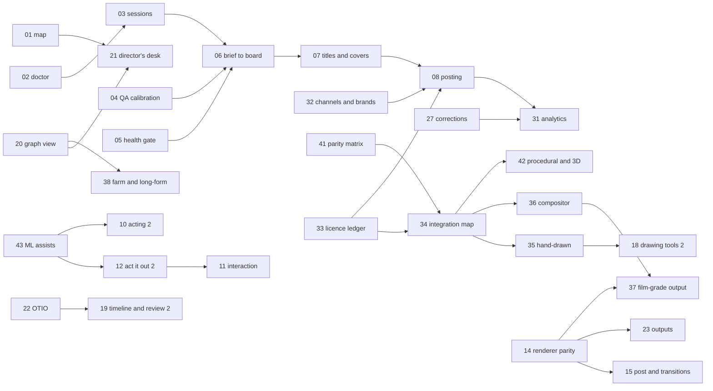

# Doodleberry work packages (from November 2026)

This is the execution plan for everything left in `docs/build-plan.md`. It groups the remaining plan items, the
"Open:" remainders of items already built, and feature-map rows that no plan item covered into work packages
(WPs). Each WP is a unit one production session can take on: it has a scope, deliverables, a measurable "done when",
dependencies, gates and a size. The build plan stays the list of items and their status; this file says in which
order, in which bundles, and how we know each is finished.

## Where things stand (2 November 2026)
- **Built:** every Phase 0, 1 and 2 item, and Phase 3 items 3.1 to 3.8 (88 commands; `python -m dbe test` runs 27
  checks). Thirty built items carry an "Open:" remainder; they are distributed into the WPs below.
- **Not started:** 3.9, 3.10, and all of Phase 4 (4.1 to 4.15).
- **The feature map is stale:** about 60 rows marked ⬜ or 🟡 are built (golden tests, schemas, visual lint, frame
  fill, safe zones, reading time, bubbles, camera grammar, foley, gesture planner, format templates, storyboard,
  timeline, posing, review room, rights, posting package, dual aspect, master to many, research gates and more).
  WP-01 reconciles it.
- **A real deadline exists:** the Q1 2027 calendar (`plan/2027-Q1.json`, 52 posts) has its first start-by date on
  **11 December 2026** (an analysis film posting 1 January), then 19, 23, 25 and 29 December. Ten of its posts are
  health topics (kidney disease, TB, dengue, snakebite, elephantiasis), which the research standard sends to an
  expert reviewer.

## Refinements to the build plan
1. **Re-scoped:** 4.4 aspect re-staging is mostly done by 1.12 (16:9 and 1:1 re-staged from the data); what remains
   is folded into WP-24. 4.10 series production builds on 2.14 (edit lists), 2.15 (series template) and 3.8 (series
   cadence), so it shrinks to continuity memory, recurring gags and a series planner.
2. **Merged:** 4.2 with 4.9 (one output pipeline for video, stills and sticker formats); 4.7 with 4.11 (library
   accounting and creator packages share the usage records); 4.12 with 4.14 and E12 (corrections, companion guides
   and living films all re-render from the facts ledger).
3. **Split:** 3.7's remainder (a Claude Code session end to end, notifications, cloud sessions) becomes WP-03; 3.8's
   remainder (re-ranking from analytics) moves to WP-31, after posts exist.
4. **Added (feature-map rows no plan item covered):** health and claims review gate; environment doctor and setup;
   multi-character interaction (handshake, hand-off, eye contact); walking along a path with foot planting; per-part
   squash and drawing substitution by angle; 12-fps-native rendering; transitions and kinetic typography; parallax
   and multiplane sets; cost and time estimate before rendering; progress events and webhooks; visual diff between
   film versions; director's desk and specialist agents; templates beyond humanoid and doodle (quadruped, bird,
   object with a face); character bible.
5. **"Done when" sharpened** for 3.9, 3.10 and every Phase 4 item (several read "as each lands" or "exists").
6. **New directions from the owner (2 November):**
   - **Several series** with different content and branding: WP-32, in M2, before a second series is planned.
   - **Professional 2D+ parity is a must**, and beyond it: it becomes the main development lane from December (about
     two thirds of development sessions), not a late milestone.
   - **All open-source code may be used**, because Doodleberry is in-house R&D and is not distributed: GPL and AGPL
     code may be vendored, modified and linked in, and non-commercial or research-only models and data may be used
     in-house. The licence ledger (WP-33) records every component's class, and the posting gate flags a public film
     that used a restricted input. The frame-by-frame drawing suite leaves the Never build list (WP-35).
7. **Sizing recalibrated:** the build plan's S/M/L assumed a developer working with an agent. In practice an agent
   session finished one M item (3.5, 3.6, 3.8) or one L item (3.7) in a few hours, including tests and docs. Each WP
   below also gives **sessions**: the expected number of such working sessions.

## At a glance
| WP | Package | Lane | When | Size | Sessions |
|---|---|---|---|---|---|
| 01 | Reconcile the plan and the feature map | studio | now to 4 Dec | S | 1 session |
| 02 | Environment doctor and one-step setup | studio | now to 4 Dec | S-M | 1 session |
| 03 | Agent sessions end to end | studio | now to 4 Dec | M | 1-2 sessions |
| 04 | Calibrate layout QA per style | studio | now to 4 Dec | S-M | 1 session |
| 05 | Health and claims review gate | studio | now to 4 Dec | S | 1 session |
| 33 | Licence ledger and vendoring | parity | now to 4 Dec | S | 1 session |
| 41 | Parity matrix (professional tools sweep) | parity | now to 4 Dec | S-M | 1 session of parallel research agents |
| 06 | From calendar to production | studio | 4 to 11 Dec | M | 1 session |
| 07 | Title, thumbnail and cover lab | studio | 4 to 11 Dec | M | 1 session |
| 32 | Channels and brands: several series side by side | studio | 4 to 11 Dec | S-M | 1 session |
| 34 | Open-source integration map | parity | 4 to 11 Dec | M | 1-2 sessions |
| 08 | Posting with a human approval per post | studio | by 1 Jan | M | 1-2 sessions |
| 09 | Motion effects and physics, finished | parity | Dec to Feb | M-L | 2 sessions |
| 11 | Interaction and locomotion | parity | Dec to Feb | M-L | 2 sessions |
| 14 | Renderer parity | parity | Dec to Feb | L | 2-3 sessions |
| 35 | Hand-drawn animation | parity | Dec to Feb | L | 3+ sessions |
| 36 | Compositor and multiplane camera | parity | Dec to Feb | L | 2-3 sessions |
| 22 | Editor hand-off | studio | Feb to Apr | M | 1 session |
| 23 | Outputs for every format | studio | Feb to Apr | M-L | 2 sessions |
| 24 | Accessibility and aspect | studio | Feb to Apr | M | 1-2 sessions |
| 25 | Localisation depth | studio | Feb to Apr | M | 1-2 sessions |
| 31 | Analytics and a plan that re-ranks itself | studio | Feb to Apr | M-L | 2 sessions |
| 15 | Post, transitions and stepped rendering | parity | Feb to Apr | M | 1-2 sessions |
| 18 | Rig Canvas and doodle tools 2 | parity | Feb to Apr | L | 2-3 sessions |
| 19 | Timeline and review room 2 | parity | Feb to Apr | M | 1-2 sessions |
| 20 | Graph view, estimates and events | parity | Feb to Apr | M | 1-2 sessions |
| 37 | Film-grade colour and delivery | parity | Feb to Apr | M-L | 2 sessions |
| 40 | Sound editing in Studio | parity | Feb to Apr | M | 1-2 sessions |
| 42 | Procedural and 3D layer (2D+) | parity | Feb to Apr | L | 3 sessions |
| 43 | ML assists, in-house | parity | Feb to Apr | M-L | 2 sessions |
| 26 | Provenance, disclosure and consent | studio | Apr to Jun | M | 1 session |
| 27 | Corrections, companions and living films | studio | Apr to Jun | M | 1-2 sessions |
| 28 | Series production | studio | Apr to Jun | M | 1 session |
| 29 | Library economics and creator packages | studio | Apr to Jun | M-L | 2 sessions |
| 30 | Other mediums | studio | Apr to Jun | M each | 1 session |
| 10 | Acting intelligence 2 | parity | Apr to Jun | M | 1-2 sessions |
| 12 | Act it out 2 | parity | Apr to Jun | M | 1-2 sessions |
| 13 | Sound depth | parity | Apr to Jun | M | 1-2 sessions |
| 16 | Sets, props, cast and templates | parity | Apr to Jun | M-L | 2 sessions |
| 17 | Bubbles and text, finished | parity | Apr to Jun | S | 1 session |
| 21 | Director's desk and specialist agents | parity | Apr to Jun | M | 1-2 sessions |
| 38 | Long-form and render farm | parity | Apr to Jun | L | 2-3 sessions |
| 39 | Team roles and permissions | parity | Apr to Jun | M | 1 session |

43 packages, about 59 to 78 agent working sessions in all; the parity lane is 24 packages and 37 to 51 sessions. WP-30 counts once (it is M per medium).

## Progress
| WP | Result | Date |
|---|---|---|
| 01 | done: feature map reconciled against the code (238 open rows reviewed; now 162 built, 53 partial, 72 open, each open row naming its WP), package scopes extended for the rows they now own, `docs.check` (commands named exist, open rows point at WPs, WP references exist, plan items covered, packages scheduled) in `python -m dbe test` | 2 Nov 2026 |
| 05 | done: expert review for health, legal and finance (channel rule, `review` on calendar rows and in briefs, `omits` required per fact, `research.check` reports pending, `prod.approve` refuses until a reviewer clears it; tested through the orchestrator), honest labels drawn with the captions; Q1's ten health posts marked | 2 Nov 2026 |
| 33 | mostly done: licence classes for every component (`licence.ledger`), `film.provenance` posting flags (in `film.package`), `UPSTREAM.json` records and `vendor.check` (in the test suite) for lottie-web, three.js, perfect-freehand and the newly vendored Potrace (GPL) and VTracer (MIT) sources. **Open:** building the two (`vendor.build`) runs their configure, make and cargo scripts, which the environment's safety check blocked pending the owner's permission | 2 Nov 2026 |
| 34 | done: `docs/oss-integration.md` decides every candidate part (drive, link, vendor or fork) with its licence class and status; one part from each of the first three groups works behind a command and is tested: Pencil2D (`pencil2d.write/render`: a drawn level round-trips with its holds), libmypaint with the MyPaint presets (`brush.paint`, linked through ctypes), Inkscape (`vector.boolean`); Synfig, OpenColorIO and OpenImageIO installed for WP-14 and WP-37; `tools/setup.sh oss`, doctor checks and manifest rows. OpenToonz's `tcomposer` (named in the done-when) has no Ubuntu package: building it needs the owner's permission, so Pencil2D stands in for the frame-by-frame group | 2 Nov 2026 |
| 41 | done: eight research agents read the manuals and release notes of Harmony 25, Moho 14.5, TVPaint 12.1, Blender Grease Pencil (4.3 to 5.2), OpenToonz 1.7 (1.8 noted), Synfig 1.4/1.5, After Effects 2025 and Nuke 16/17; `parity/<tool>.json` holds 214 chapters and 1,396 capabilities in our own words, each with how professionals use it and our match; `parity.check` (in `python -m dbe test`) checks every command and WP it names; `docs/parity-matrix.md` is generated by `parity.matrix`. Coverage: 35% covered, 66% covered or partial; by tool from Grease Pencil 21% / 58% to Synfig 47% / 72%. Twenty capabilities no package covered were added to WP-11, 15, 18, 22, 35, 36, 37 and 42; one overstated feature-map row corrected. Re-run at the end of each parity phase | 2 Nov 2026 |
| 08 | done: `post.queue/approve/revoke/run/done/status` and the board's Posting section; one named approval per post; blocked posts (package checks) and flagged posts (provenance) gated; export with a calendar reminder, or a connector; links close the calendar row. Measured on Q1's first full week (4 to 10 January) with four rendered films standing in: two approved films went out on their days (YouTube through the dry-run connector, five platforms exported with reminders at 18:30 Colombo time), the unapproved film was held on all six platforms, a film whose facts lack sources could not be approved, and after the links came back the tracker shows those rows posted. Real platform connectors need the owner's app credentials | 2 Nov 2026 |
| 04 | done: per-style thresholds and enforced checks in `dbe/profiles.json` `layout_styles` (explainer, doodle, cartoon), calibrated on eleven reference films rendered here; the AI-look lint (shadows, gradient blobs, glows, emoji, centred everything; house set gradients exempt) in `qa.run`; every reference passes its style's enforced checks, and a seeded failure of each check fails QA in each style (`python -m dbe test` layout). Calibration found and fixed: kit-demo's title in the bottom UI band, Nib entering from off-screen, the classroom board's first line under the top bar; and in the measures: a kit face counts as the cold-open character, caption pace only with captions on, invisible or pushed-out text no longer counted, close cues no longer misread as early. Seams stay advisory (hard cuts measure 17 to 168; dissolves are WP-15) | 2 Nov 2026 |
| 32 | done: channels by id (`plan/channels/<id>/`: channel, idea bank, quarters; the live plan moved to `science`), `channel` on every plan command, `plan.channels`, `plan.cross` (week by week, same-subject clashes across channels), brand kits by id (`brand/<id>.json`, `shots.json` `"brand": "<id>"`), briefs carry the channel's cast, voices and brand, the board colours and filters by channel, the Plan page picks a channel. Two channels (science and a sample kids channel with other audience, fields, posting days, series and brand) each plan a quarter that passes its own rules, the cross view catches a seeded same-subject week, and their films carry their own palettes (rendered: explainer-demo in the sample kit comes out with its own wordmark, heading and caption colours). The scheduler grew a repair pass: 47 of 48 made-up quarters pass every rule (29 of 48 before). The second series itself is the owner's to define | 2 Nov 2026 |
| 07 | done: `dbe/packaging.py`: the packaging truth check (numbers, absolutes, causal claims against the film's facts and narration; myth films may ask or deny, never state), the newcomer check, double-barrel thumbnails, `title.check/propose/set`, `titles.status`, and `cover.make` (a scored frame per cut, brand-kit text in the calm band of the safe area, per platform). The back catalogue retitled: all 25 films with a script carry two true titles and two true thumbnails in `titles.json` (one Spanish film in Spanish); covers for every cut and platform of the eleven films rendered here (144 covers); a seeded misleading title ("Cracking your knuckles causes arthritis") is contradicted. `film.package` uses the chosen title and checks it | 2 Nov 2026 |
| 06 | done: `plan.brief` drafts the storyboard from the row's format template (new `explainer` template; `myth_vs_data`, `dialogue`) in the idea's own words with unsourced facts, and with `launch` puts it on the board with its plan row and starts its session, committing the brief and draft on the film's branch in its workspace; `voice.build` refuses a draft; board cards show start-by, fact-lock and review. Measured in a scratch clone: the first eight Q1 rows each took one command (0.9 to 1.3 s); all eight storyboards pass `storyboard.check`; three sessions run and five queue behind `max_parallel` 3; the tracker shows all eight in production and none overdue. Sessions here were manual runners: Claude Code sessions are WP-03 | 2 Nov 2026 |
| 02 | done: `engine.doctor` (core, audio, tools; fixes for every gap; doctor self-test), `tools/setup.sh` (idempotent; 1 min 49 s here with the big wheels, 11 s when nothing is missing), `tools/fetch_wheels.py`, `requirements-core.txt` (the core packages were in no requirements file). Not verified on a truly fresh container: this one already had most tools | 2 Nov 2026 |

## Definition of done (every WP)
- Features are `@command` functions in `dbe/commands.py` (CLI, HTTP, Studio and MCP at once), with JSON-safe
  arguments and results; any UI is a Studio page that calls only commands.
- A self-test in `python -m dbe test` that fails when the feature breaks (synthetic inputs where real ones are
  external), and the whole suite green before commit; golden frames updated only for intended visual changes.
- A measured demonstration of the "done when" (numbers in the commit message and the plan's status row).
- `docs/dbe.md` section, build-plan status row, feature-map rows updated; every new dependency, model or asset
  recorded in the licence ledger (`assets/manifest.json`) with its licence class (no class is refused; the posting
  gate reads it), and vendored code kept under `vendor/` with its upstream and notices (WP-33); puppet-format changes bump `version` and reach
  `puppet.js`, `acting.js`, `bake.mjs`, `dbe/geom.py` and the exporters together.
- Nothing downloaded (asset packs, renders, voices, models) committed; anything that spends money, posts publicly
  or runs paid sessions waits for the owner's go-ahead.

## Order of work: two lanes
Development runs in two lanes. The **parity lane** is the main one (about two thirds of development sessions): it
closes every gap with professional 2D+ software and goes beyond it. The **studio lane** keeps the Q1 2027 calendar
on track and grows reach and trust. Until 11 December the studio lane has priority, because of the calendar's first
start-by date.

| When | Studio lane (about one third) | Parity lane (about two thirds) |
|---|---|---|
| now to 4 Dec | **M1** ready to produce: 01, 02, 03, 04, 05 | 41 parity matrix, 33 licence ledger and vendoring |
| 4 to 11 Dec | **M2** first quarter on air: 06, 07, 32 (08 before the first post on 1 Jan) | 34 open-source integration map |
| Dec to Feb | 08; Q1 production runs on the board | 35 hand-drawn animation, 36 compositor and multiplane camera, 14 renderer parity, 09 effects and physics, 11 interaction and locomotion |
| Feb to Apr | **M6** reach: 22, 23, 24, 25; **M8** learning loop 31 from mid-February | 42 procedural and 3D layer, 43 ML assists, 37 film-grade colour and delivery, 40 sound editing, 18 drawing tools 2, 15 post and transitions, 19 timeline and review 2, 20 graph view |
| Apr to Jun | **M7** trust, community, economy: 26 to 30 | 38 farm and long-form, 39 team roles, 21 director's desk, 12 act it out 2, 10 acting 2, 13 sound depth, 16 sets, cast and templates, 17 bubbles and text |

Work-package IDs are stable labels, not an order: this table gives the order. The section headings below (M3 to M5)
group packages by theme; their dates follow this table.

## M1 Ready to produce (now to 4 December)

**WP-01 Reconcile the plan and the feature map** (S, 1 session)
- Scope: mark built rows ✅ with the command that does it; mark partial rows 🟡 with what is left; point each open
  row at its WP. A `docs.check` command that cross-checks the build-plan status table, the feature map and the
  command registry (every command named in the docs exists; every plan item has a status row; no ✅ row without a
  command or file).
- Done when: `docs.check` passes in `python -m dbe test`, and the feature map's open P0 rows each name a WP.

**WP-02 Environment doctor and one-step setup** (S-M, 1 session)
- Learned the hard way this session: pip stalls on large wheels (curl downloads worked), MediaPipe needs `libegl1`,
  scipy and the voice stack were missing, Kokoro model files and the timed model are fetched by hand.
- Scope: `engine.doctor` (Python packages and versions against the requirements files, system libraries, Node and
  Playwright's browser, ffmpeg, model files with their pinned sha256, voices, disk) with the exact fix for each gap;
  `tools/setup.sh` (idempotent: apt packages, wheels fetched with curl and installed from a local folder, models,
  voices); the cloud environment's setup script documented.
- Done when: a fresh container goes from clone to a green `python -m dbe test` with one script, and `engine.doctor`
  reports every check green.

**WP-03 Agent sessions end to end** (M, 1-2 sessions; needs the owner's go-ahead for session spend)
- Scope: run the `claude` runner on a real Q1 brief in a scratch clone, research gate to final checkpoint to merge;
  fix protocol gaps it finds; record time and token cost per film. Owner notifications on escalation, failure and
  ready-for-approval (progress events and webhooks, feature map §11); start cloud sessions from the board through the
  manual runner's protocol.
- Done when: one film from a brief is made by a Claude Code session, escalates once on seeded counter-evidence, is
  approved and merged, and the owner was notified at each stop; cost per film is in the board's measurements.

**WP-04 Calibrate layout QA per style** (S-M, 1 session; the build plan's gate before enforcing 0.11)
- Scope: a generic-AI-look lint (shadow cards, gradient blobs, emoji, neon glow, centred everything); run frame fill,
  seams and reading time on reference films in each style (flat paper explainer, doodle,
  cartoon cast); set per-style thresholds in `dbe/profiles.json`; enforce the calibrated checks.
- Done when: every benchmark film passes its style's thresholds, and a seeded failure in each style fails QA.

**WP-05 Health and claims review gate** (S, 1 session)
- Scope: a brief field and ledger role for expert review (`expert_review`), set automatically for health, legal and
  finance fields; renders refuse to reach the final checkpoint without a cleared expert review; honest on-screen
  labels (re-analysis, illustration, preliminary) checked against facts.json labels; what the source omits recorded.
- Done when: the ten Q1 health posts carry the flag in their briefs, and a health film cannot be approved on the
  board without a recorded expert review.

## M2 First quarter on air (4 to 11 December, then through Q1)

**WP-06 From calendar to production** (M, 1 session; feature map E24)
- Scope: `plan.brief` picks a format template by the row's format (myth_vs_data for the series, explainer,
  dialogue), drafts the storyboard with `film.from_template` from the idea's fields, sets research instructions with
  the fact-lock date, and puts it on the board with its posting date; the tracker reads the fact gate from the film's
  workspace; the board shows each film's plan row (start-by, fact-lock, posting date).
- Done when: the first eight Q1 rows go from calendar to a storyboard passing `storyboard.check` to a running session
  in one command each, and the tracker shows them on schedule.

**WP-07 Title, thumbnail and cover lab** (M, 1 session; plan 3.9)
- Scope: title candidates written for newcomers that are literally true; double-barrel thumbnail text; candidates
  checked against facts.json (the packaging truth check: no claim in a title or cover that the film does not
  support); deliberate cover frames per cut and platform (chosen frame plus brand-kit text); back-catalogue retitling.
- Done when: every merged film has two true title options, a cover per cut and platform, and the truth check fails a
  seeded misleading title.

**WP-08 Posting with a human approval per post** (M, 1-2 sessions; plan 4.15; publishing gate)
- Scope: a posting queue from `film.package` outputs and the calendar; per-post approval on the board; connectors
  only where platform terms allow automation, otherwise an export with a reminder; posted links back into
  `plan.posted`; multi-language audio tracks where the platform supports them.
- Done when: a week of approved Q1 posts goes out on schedule (or is exported with reminders), none without an
  approval, and the tracker shows them posted.

**WP-32 Channels and brands: several series side by side** (S-M, 1 session; owner request)
- Before WP-32: one channel (`plan/channel.json`), one idea bank, one brand kit (`brand/brand.json`). Films could already look
  and sound different (brand, cast, sets, voices and formats are per film), and the board runs any mix of films.
- Scope: channels by id (`plan/channels/<id>.json`: audience, fields, locale, rules, brand kit, default cast and
  voices); ideas and calendars tagged by channel, with sweeps run per channel; `plan.schedule` and `plan.check` per
  channel, plus a cross-channel view (no two channels posting the same subject the same week, if wanted); several
  brand kits (`brand/<id>.json`), with a channel's films inheriting its brand, cast and voices; `prod.plan` records the
  channel; the board and the Plan page filter and colour by channel. The current files migrate to a first channel.
- Done when: two channels with different audiences, fields, rules and brands each get a quarter that passes its own
  rules, films from each render in their own brand, and the board shows both apart.

## M3 Acting and motion depth (parity lane)

**WP-09 Motion effects and physics, finished** (M-L, 2 sessions; open from 2.19, 2.20)
- Scope: smear frames and motion arcs; multi-body scenes with deterministic Rapier; squash on impact; contacts
  retimed onto the beat grid.
- Done when: a juggling scene of three props is solved, lands on beats, gets smears and arcs, and reruns hash-equal.

**WP-10 Acting intelligence 2** (M, 1-2 sessions; open from 2.3, 2.4, 2.11)
- Scope: semantic gestures from LLM tags (agent output validated against the clip library); personality profiles
  (E13) that shape tempo, energy and gesture choice; camera beats in gags (push-in on the stare); a critic's rating
  of acting and gag timing against a hand-keyed baseline.
- Done when: two characters with different profiles act the same script visibly differently, and the critic rates the
  planner at or above the hand-keyed version on a blind pair.

**WP-11 Interaction and locomotion** (M-L, 2 sessions; new from the feature map)
- Scope: IK/FK switching and blending; copy-rotation and follow-path constraints; handshake, hug, hand-off and eye
  contact (IK targets on another character's parts); walking along a path
  with foot planting; per-part squash and stretch; drawing substitution driven by angle; per-pose z-order. Puppet
  format v0.8 if new fields are needed.
- Added by the parity sweep (WP-41): free per-part attributes in the puppet format; fill winding rules; automatic vertex weights from bone influence; phoneme poses that drive the whole face, not only the mouth.
- Done when: two characters walk to each other along a curved path without foot sliding (measured), shake hands with
  hands meeting within 2 px, and every renderer plays it.

**WP-12 Act it out 2** (M, 1-2 sessions; open from 3.5)
- Scope: head turn (yaw) into the `turn` control (clip control tracks, a puppet-format change); more detectors, now
  that their licences allow in-house use: rtmlib RTMPose, OpenPose, Ultralytics pose and Sapiens (chosen by measured
  accuracy on our takes, WP-43); multi-person takes (one clip per person); BVH and CMU motion capture retargeted to 2D clips; camera-motion compensation from the background; live
  tracking (E9) as a P2 follow-on.
- Done when: a take with a head turn and a camera pan becomes a clip whose head turns and whose root does not drift,
  and two people in one take become two clips.

**WP-13 Sound depth** (M, 1-2 sessions; open from 2.1, 2.7, 2.13, 2.16)
- Scope: foley surfaces and room reverb per set; Kenney CC0 samples (manifest); human voice-over import with
  phone-level alignment (CTC or MFA) and recorded takes fitted to slots with `atempo`; prosody direction (whisper,
  shout, excited) where the TTS allows it.
- Done when: a recorded human line drops into a slot with visemes within 40 ms of a hand check, and footsteps sound
  different on grass and tile.

## M4 Look and renderer parity (parity lane)

**WP-14 Renderer parity** (L, 2-3 sessions; open from 1.1, 1.7, 1.8, 2.13, 2.20 and 3.5)
- Scope: raster parts, toon shading, motion effects, clip-driven z order, props and the sound-off time warp in Synfig,
  Lottie and Grease Pencil, or a clear refusal where a renderer cannot; a parity golden test that renders the same
  shot in each renderer and compares silhouettes.
- Done when: the parity test passes for every benchmark shot on every renderer that accepts it.

**WP-15 Post, transitions and stepped rendering** (M, 1-2 sessions; open from 1.7; feature map §4, §7)
- Scope: cross-dissolves, match cuts and wipes; medium simulation for vector lines (pencil, marker, crayon) and a
  watercolour pass; the static-layer cache left from 0.1; sub-frame motion blur on fast shots only; kinetic typography beyond
  word highlights; parallax and multiplane set layers; 12-fps-native rendering (render only unique stepped frames).
- Added by the parity sweep (WP-41): strokes that draw themselves on and off; a stroke's width profile along its length; colour that varies along a shape; line boil only while a shape moves.
- Done when: a doodle film on twos renders in at most 60% of today's time with identical frames, and each transition
  passes the seam check.

**WP-16 Sets, props, cast and templates** (M-L, 2 sessions; open from 1.5, 1.6)
- Scope: palette variants per scene (night, sick, cold); a character family look as parameters on top of
  `cast.generate`; map board (Natural Earth plus d3-geo), anatomy plates (Servier, CC BY), Kenney prop packs; Open Peeps and
  Humaaans converted; outfits as swap sets; templates for a quadruped, a bird and an object with a face, each with a
  clip library; a character bible (personality, voice, gesture tendencies, continuity notes) in the cast registry.
- Done when: a Q1 analysis film uses the map board; three new templates each pass a clip set on every renderer;
  every new file is in the manifest.

**WP-17 Bubbles and text, finished** (S, 1 session; open from 2.10)
- Scope: thought clouds, narration boxes, letter-by-letter typewriter with punctuation pauses.
- Done when: the sound-off cut of a dialogue film uses all three and passes the reading-time rule.

## M5 Artist and director tools (parity lane)

**WP-18 Rig Canvas and doodle tools 2** (L, 2-3 sessions; open from 1.3, 1.4, 1.8, 3.6)
- Scope: expression and mouth-chart boards side by side with onion skin; model sheet and turnaround board; polygon
  editing of suggested cuts; several characters on one page; pupils, turn views and chains drawn over ghost guides;
  Krita `.kra` import; click-to-mask cut suggestions with SAM 2.1 tiny or small (1.8b).
- Added by the parity sweep (WP-41): named layer sets switched together; a mirror tool for vertices; gradient and texture fills on puppets.
- Done when: a page with two doodles becomes two puppets, and a doodle gains pupils and a three-quarter view through
  drawing requests alone.

**WP-19 Timeline and review room 2** (M, 1-2 sessions; open from 3.1, 3.4; after WP-22)
- Scope: dragging lines and shots; a camera-keys lane; a curve (graph) editor for keys; named shot sizes and
  over-the-shoulder framing; continuity checks in lint (180-degree rule, screen direction, eyeline); review notes about gaze, placement, camera and the timing of
  lines; review on a phone; a visual diff between two versions of a film; OpenRV or xSTUDIO through OTIO.
- Done when: "Ravi should look at Momo when she answers" is fixed and verified by the critic, and the diff view
  shows exactly the frames that changed.

**WP-20 Graph view, estimates and events** (M, 1-2 sessions; plan 3.10; feature map §11)
- Scope: React Flow node view of facts, script, shots and renders with per-node cache state and why a node is stale;
  re-cook downstream only; a cost and time estimate before rendering (frames times renderer rate, measured);
  progress events and webhooks for long jobs.
- Done when: clicking a stale node shows the changed input and re-cooks only its downstream nodes, and the estimate
  is within 20% of the measured render time on the benchmark films.

**WP-21 Director's desk and specialist agents** (M, 1-2 sessions; feature map §11, §12; after WP-01 and WP-20)
- Scope: a chat beside the storyboard strip and animatic; role command subsets for director, animator, editor, critic
  and fact-checker (what each may call); natural-language edits routed to the right commands.
- Done when: a director edits a film by chat alone through five kinds of change, and each role is refused commands
  outside its subset.

## M6 Reach (studio lane, February to April)

**WP-22 Editor hand-off** (M, 1 session; plan 4.1)
- Scope: OTIO, FCPXML and EDL with stems and captions; a round trip through `melt`.
- Added by the parity sweep (WP-41): camera track export for editors and compositors.
- Done when: a film opens in Kdenlive (and Resolve, where available) with shots, stems and captions in place, and the
  `melt` round trip renders frames identical to ours.

**WP-23 Outputs for every format** (M-L, 2 sessions; plans 4.2 and 4.9)
- Scope: WebM and ProRes with alpha; GIF and APNG; line-art GIFs (32 colours, Bayer dithering); sticker and emoji packs
  (Telegram WebM and TGS, WhatsApp WebP, Giphy GIF, iMessage APNG); print-ready stills; dotLottie with palette
  themes; Lottie QA in two independent renderers.
- Done when: one character exports to four sticker platforms within each platform's limits, and Lottie exports pass
  golden checks in lottie-web and a second renderer.

**WP-24 Accessibility and aspect** (M, 1-2 sessions; plans 4.3 and 4.4's remainder)
- Scope: audio description generated from shot data (E5); flash check (WCAG 2.3); colour-blind check on frames;
  reduced-motion variant; one command for 9:16, 16:9 and 1:1 with per-aspect QA.
- Done when: every final ships with an AD track and passes the flash check, and the three aspects pass QA from one
  command.

**WP-25 Localisation depth** (M, 1-2 sessions; plan 4.5; open from 1.15)
- Scope: translated on-screen text in sets and kit elements; right-to-left and complex scripts; cultural swaps of sets
  and props; a Sinhala voice (any open model may be used in-house; a voice not marked clean is flagged at
  posting).
- Done when: an Arabic version renders correctly end to end, and a Sinhala version ships with captions and, if a clean
  voice exists, voice.

## M7 Trust, community, economy (studio lane, April to June)

**WP-26 Provenance, disclosure and consent** (M, 1 session; plan 4.6)
- Scope: C2PA content credentials on finals; AI-disclosure labels per platform; likeness and consent records for
  characters and voices.
- Done when: finals carry signed provenance that verifies with a reference tool, and a voice without a consent
  record is refused.

**WP-27 Corrections, companions and living films** (M, 1-2 sessions; plans 4.12, 4.14, 4.8's E12)
- Scope: a dated corrections log per film that propagates to captions, titles, covers and credits; runnable companion
  guides that reproduce a film's numbers from its analysis scripts; send-a-myth intake into the idea bank; films that
  re-render when their facts change; a whole catalogue (films, covers, posts) re-rendered in a new brand kit (E30).
- Done when: one correction updates the page, captions, title and credits in one command, and a companion guide
  reproduces every number in its film.

**WP-28 Series production** (M, 1 session; plan 4.10, re-scoped)
- Scope: continuity memory (who knows what, running gags, props that persist); recurring gags as data; a series
  planner on top of 3.8; teaching mode that turns a pipeline into a tutorial.
- Done when: ten episodes of a series are planned, rendered and scheduled from data with continuity checked.

**WP-29 Library economics and creator packages** (M-L, 2 sessions; plans 4.7 and 4.11)
- Scope: usage accounting from `shots.json` (screen time per asset, E15); contributor flow through `cast.add`; rig,
  boil-preset and loop-pack templates; handwriting fonts from an artist's samples.
- Done when: a per-asset screen-time report covers the whole catalogue, and a creator packages a rig template that
  installs into another project.

**WP-30 Other mediums** (M each; plan 4.8)
- Scope: comics and storybooks from shot data (Typst), one character in every medium (E6), interactive web films,
  Godot export.
- Done when (each): a film becomes a printable comic, or an interactive web film, from its data alone.

## M8 Learning loop (studio lane, from mid-February)

**WP-31 Analytics and a plan that re-ranks itself** (M-L, 2 sessions; plan 4.13, E11, E31; open from 3.8)
- Scope: the 48-hour metrics checklist; ingestion per platform where terms allow (manual import otherwise);
  retention curves mapped onto shots and lines; hook variants tested (E11); audience polls between true title options
  (from `titles.json`, WP-07); the idea bank and next quarter's calendar
  re-ranked by what performed; a business dashboard (revenue by platform and geography, RPM, catalogue value).
- Done when: Q2 2027's calendar is planned with measured Q1 performance and the change it made is explained row by
  row.

## M9 Professional parity core (the main lane, December to June)
Where Doodleberry still trails professional 2D+ software (Toon Boom Harmony, Moho, TVPaint, Blender's Grease Pencil,
OpenToonz, After Effects, Nuke): hand-drawn frame-by-frame animation, painting tools, a compositor, a 2D multiplane
camera, film-grade colour and delivery, long-form scale, team features and sound editing; and the procedural and 3D
side of "2D+". The way to close it is to bring open-source codebases inside Doodleberry and build on them. For each
part, WP-34 chooses one of three ways: drive the program headless (fastest to start), link or vendor its libraries,
or fork it (when we need to change its internals). Every result sits behind `@command`s with self-tests, so agents
drive it like everything else.

**WP-41 Parity matrix (professional tools sweep)** (S-M, 1 session of parallel research agents; first in the lane)
- Scope: agents read the manuals and release notes of Harmony, Moho, TVPaint, Blender Grease Pencil, OpenToonz,
  Synfig, After Effects and Nuke, and write a structured inventory: each capability in our own words, how
  professionals use it, and our match (a command, a data field, a metric, or a gap with its WP). No copied text,
  icons or UI.
- Done when: the matrix covers every chapter of each manual, every gap names a WP, and the feature map is updated
  from it. It is re-run at the end of each parity phase to measure coverage.

**WP-33 Licence ledger and vendoring** (S, 1 session)
- Scope: `vendor/<name>/` with `UPSTREAM.json` (repository, version or commit, licence, files taken, local patches
  kept as small commits so upstream fixes can be pulled) and the original notices; a licence class for every
  component in the ledger (permissive, copyleft, network copyleft, source-available, non-commercial, research-only,
  share-alike); each render records which classed components shaped it (models, voices, data, assets, vendored code
  in its path); the posting gate (WP-08) flags a film that used a non-commercial, research-only or share-alike input
  for the owner's decision; `vendor.check` verifies notices, upstream records and ledger rows. No class is refused.
- Done when: one GPL codebase and one permissive one are vendored and built from `vendor/`, and a film voiced with a
  non-clean voice is flagged at posting with the reason.

**WP-34 Open-source integration map** (M, 1-2 sessions; after WP-41)
- Scope: for each parity gap, the codebases that close it, built and run headless in our container, and a decision
  per part (drive, link or vendor, fork), with a first part working behind a command. Candidates:
  - frame-by-frame, exposure sheet, levels: OpenToonz (and its fork Tahoma2D), Pencil2D;
  - painting and brushes: Krita's brush engines, libmypaint (MyPaint brushes);
  - vector editing and deformers: Synfig core, Inkscape;
  - compositing: Natron and its OpenFX plugins, Blender's compositor;
  - colour and image formats: OpenColorIO, OpenImageIO, OpenEXR;
  - editing and review: Kdenlive and MLT, Olive, OpenRV, xSTUDIO;
  - sound: Audacity, Ardour;
  - farm: OpenCue, Flamenco, CGRU Afanasy;
  - 3D and procedural: Blender (`bpy` in-process), Rapier, Bullet, Manifold, OpenUSD.
- Done when: a written decision per part with its licence class, and one part from each of the first three groups
  working behind a command (for example a scene rendered from data by OpenToonz's `tcomposer`).

**WP-35 Hand-drawn animation** (L, 3+ sessions; after WP-34)
- Scope: drawn levels as a new part type (a sequence of drawings with exposures; a puppet-format change); onion skins;
  an exposure sheet (X-sheet) for timing on ones, twos and threes; key poses with in-between assistance (WP-43);
  cleanup of rough lines; colour styles applied across every frame; hand-drawn effects (fire, water, smoke) as drawn
  levels; built on OpenToonz's level and X-sheet model where WP-34 chose it.
- Added by the parity sweep (WP-41): camera capture for stop motion and pencil tests.
- Done when: an animator draws a 2-second hand-drawn effect and a 12-drawing walk on twos in Studio, and both play in
  a film beside rigged puppets, with golden frames, on every renderer that accepts drawn levels.

**WP-36 Compositor and multiplane camera** (L, 2-3 sessions; after WP-34)
- Scope: a per-shot node compositor (masks, mattes, blend modes, glows, light wraps, blurs, colour corrections)
  rendered deterministically, on Natron or Blender's compositor or in-house WebGL nodes as WP-34 decides; true 2D
  multiplane depth (layers on planes, parallax, depth of field) in the SVG and WebGL path; the graph view (WP-20) as
  its editor.
- Added by the parity sweep (WP-41): a region tracker that outputs hooks; deforming a nested group as one; gradient layers, tool and editor; picture analysis driving parameters; per-parameter expressions of the frame; camera roll.
- Done when: a night shot with three depth planes, a glow and a mask renders identically on rerun and matches its
  golden frames.

**WP-37 Film-grade colour and delivery** (M-L, 2 sessions)
- Scope: colour management (OpenColorIO, ACES); OpenEXR multi-pass output (beauty, line, shadow, mattes); 4K and
  higher-frame-rate masters; an HDR master where the pipeline allows it; a cinema-style package as a delivery profile.
- Added by the parity sweep (WP-41): stereoscopic output; slate frames on renders; scopes (histogram, waveform, vectorscope).
- Done when: a film renders a 4K ACES EXR multi-pass master that a reference tool reads, and the social encodes are
  derived from it.

**WP-40 Sound editing in Studio** (M, 1-2 sessions)
- Scope: waveform lanes for voice, music, foley and effects in the timeline; moving, trimming and replacing cues;
  stems; Audacity or Ardour driven (or linked) for deeper edits, and a vendored waveform component in Studio.
- Done when: a sound designer moves a foley hit and swaps a music cue in Studio, and the mix re-renders with the
  change at the right frame.

**WP-42 Procedural and 3D layer (2D+)** (L, 3 sessions; the brainstorm's 5A and 5B)
- Scope: procedural 2D (scatter, instancing, growth, crowds of props and characters as data, rules on the beat grid);
  particles (rain, sparks, snow), crowds with variation, cloth strips; Blender in-process (`bpy`) for 3D sets, Geometry Nodes, Grease Pencil 3 and EEVEE passes composited with 2D;
  physics beyond Rapier 2D (Bullet for 3D props); OpenUSD as the scene interchange. GPU solvers (5C) wait for a GPU.
- Added by the parity sweep (WP-41): animatable parametric primitives; live renders from a game engine into the comp.
- Done when: a shot mixes a procedural crowd, a Geometry Nodes 3D set and 2D puppets with one camera, renders
  deterministically, and re-cooks only the changed node.

**WP-43 ML assists, in-house** (M-L, 2 sessions)
- Scope: models the old rule kept out, used as assistants whose output is data that a person or the critic accepts:
  pose detectors for Act it out (OpenPose, Ultralytics, Sapiens; compared on our takes); expressive and own-voice TTS
  (XTTS-v2, F5-TTS; cloning only with recorded consent); co-speech gesture models (EMAGE/BEAT2, audio2photoreal) as
  suggestions for the gesture planner; in-between proposals for drawn levels and morphs between views (front to three-quarter to side); depth estimates (Depth Anything, larger
  models) for parallax; sound sketches (Stable Audio Open). Each output carries its licence class into the film's
  record, so the posting gate can flag it.
- Done when: each assist improves a measured baseline (pose accuracy, gesture rating, in-between acceptance rate) on
  our own material, and its outputs are flagged correctly at posting.

**WP-38 Long-form and render farm** (L, 2-3 sessions; after WP-20)
- Scope: distributed render workers (OpenCue, Flamenco or an in-house queue), a shared cache by content hash,
  scheduling by cost estimate; a long-form test (a 20-minute episode) for memory, cache and assembly limits.
- Done when: a 20-minute episode renders on three workers in a third of one machine's time, with frames identical to
  a single-machine render.

**WP-39 Team roles and permissions** (M, 1 session)
- Scope: people and roles (owner, director, artist, reviewer, editor) with the command subsets of WP-21; assignments
  and locks on films and characters; an audit log of who changed what. Useful even for one person and many agents:
  each agent session gets a role.
- Done when: an artist session can edit a character but not approve a film, and every change appears in the audit
  log.

## Decisions for the owner
- **Resolved on 2 November 2026:** all open-source code may be used in-house, GPL and AGPL included, and vendored,
  modified or linked; non-commercial and research-only models and data may be used in-house; frame-by-frame drawing
  is in scope (WP-35); professional 2D+ parity is a must.
- **Still yours, per case:**
  - Posting a film the gate flags because a non-commercial, research-only or share-alike input shaped it.
  - Model spend for agent sessions (WP-03 film sessions, WP-41 research agents), each with an estimate first.
  - Hardware: a GPU for 5C solvers and for heavy models (Sapiens, F5-TTS and diffusion models run slowly on CPU).
  - Consent before cloning any real person's voice or likeness, including your own (WP-26, WP-43).

## Risks and how the plan handles them
- **Publishing with restricted inputs:** the ledger tracks every component's class into each film's record; the
  posting gate flags, the owner decides. Characters stay original designs, whatever the code's licence.
- **Integration weight:** OpenToonz, Natron, Synfig and Krita are large C++ codebases, slow to build headless. WP-34
  starts by driving programs, and vendors or forks only the parts we must change; upstream records keep forks
  mergeable.
- **Platform terms:** posting and analytics automate only where terms allow; otherwise exports and manual import.
- **CPU contention:** the container has four cores; production sessions (renders) and development sessions compete.
  During Q1, keep `max_parallel` at 2 while a development WP is running. Heavy builds (C++ codebases) run outside
  production hours.
- **Session spend:** WP-03 measures the cost per film before the claude runner is used at volume.
- **Research quality:** sweeps and sessions may cite pages they could not fully read; the fact gate, the expert review
  (WP-05) and the URL check stay mandatory, and research that contradicts a brief escalates to the owner.
